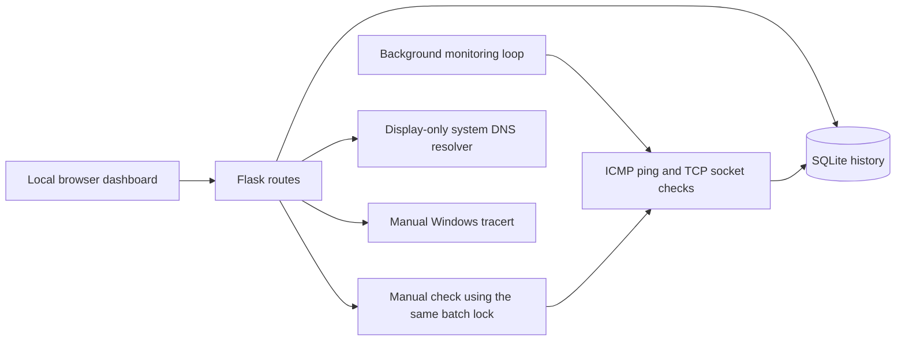

# NetScope

A student-built network monitoring and diagnostics project for a computer engineering portfolio. NetScope combines a local Flask dashboard, independent ICMP and TCP checks, and persistent SQLite measurements to help explain what a network check can—and cannot—tell you.

The dashboard uses real backend results. There are no simulated production measurements. This is a local, single-user learning tool for systems you own or have permission to test.

## Features

| Area | Implemented behavior |
| --- | --- |
| Device monitoring | Add named loopback/private IPv4 devices and a TCP service port; view independent checks in a compact, sortable dark-mode device table. |
| ICMP | Five Echo Requests per device per cycle; parse actual ping replies and completed batch statistics. |
| Packet loss | Sent, received, unanswered, and percentage lost within each completed five-probe cycle. |
| RTT | Reply-derived average/minimum/maximum RTT; preserve `<1 ms` bounds and show unavailable measurements as N/A. |
| TCP | Independent connection checks with distinct refusal, timeout, network-error, and unavailable diagnostics. |
| History | SQLite-backed latency and packet-loss charts, device selection and history navigation, empty/loading/error states. |
| Availability | Separate ICMP and TCP check availability summaries with valid/excluded sample counts, observation windows, and a success/failure/unknown timeline. |
| DNS | Manual, display-only system resolver lookup of public domain names; show available IPv4/IPv6 results, duration, and explanatory errors. |
| Traceroute | Manual Windows `tracert -d -4` to an explicitly authorized private/loopback destination; three measurements per hop and reached/incomplete/failure states. |
| Safeguards | Strict destination validation, bounded commands and inputs, local browser request boundary, diagnostic rate limits, and prevention of overlapping monitoring batches. |

## Screenshots

These are genuine captures from an isolated loopback-only preview using real SQLite records and ping/TCP results. Unavailable exact RTT remains N/A; the interface does not manufacture numerical samples. See [screenshots/README.md](screenshots/README.md) for provenance and the capture/privacy checklist.


## Technologies

- Python 3.10+; Flask for routes/templates and Werkzeug for HTTP errors.
- Python standard library: SQLite, sockets, subprocesses, IP validation, threading, and unit tests.
- HTML, CSS, and vanilla JavaScript with Canvas charts; no frontend framework or chart dependency.
- Windows system `ping.exe` and `tracert.exe`.
- Node.js built-in test runner for frontend regression tests; Node is optional for running the app.

`requirements.txt` lists the two directly imported third-party Python packages. Their transitive dependencies are installed by pip. SQLite is included with Python; no database server or npm installation is required.

## Architecture



`app.py` owns validation, monitoring, persistence, availability classification, and routes. `dns_diagnostics.py` and `traceroute_diagnostics.py` isolate manual diagnostics. Neither diagnostic automatically runs during monitoring or writes lookup/trace results to the monitoring database.

One daemon monitoring thread checks devices sequentially. A process-local lock prevents duplicate manual/background batches and device changes during a batch. The configured interval is a delay **after** the batch finishes, so the actual sampling period includes probe execution time. The browser refreshes device data every 10 seconds.

SQLite stores targets and timestamped results, uses WAL mode and parameterized request values, and applies additive migrations for older databases. History responses and availability summaries cover the latest **60 stored rows per device**, with history returned chronologically. Older rows remain stored.

```text
netscope_starter/
├── app.py
├── dns_diagnostics.py
├── traceroute_diagnostics.py
├── requirements.txt
├── templates/index.html
├── static/
│   ├── app.js
│   └── style.css
├── tests/                    # Python and JavaScript regression tests
├── screenshots/              # Capture instructions and empty category folders
├── AUDIT.md                  # Preserved technical audit
├── README.md
└── .gitignore
```

The runtime database and virtual environment are deliberately absent from the publication tree.

## Windows setup

Prerequisites: Windows, Python 3.10 or later with the Python launcher, and a browser. Windows provides the ping and traceroute commands. Git is useful for cloning but is not an application dependency.

In PowerShell, open the project directory and run:

```powershell
py --version
py -m venv .venv
.\.venv\Scripts\python.exe -m pip install -r requirements.txt
.\.venv\Scripts\python.exe app.py
```

These commands use the virtual environment directly; activation and changes to PowerShell execution policy are unnecessary. Paste `http://127.0.0.1:5000` into the browser address bar. Press Ctrl+C in the terminal to stop the application.

The supplied entry point binds only to `127.0.0.1:5000`, with debug mode and the reloader disabled. Use this entry point so database initialization and the background thread run. Do not expose it through a public binding, tunnel, proxy, or multiple worker processes.

A new database seeds **Local computer**, `127.0.0.1`, TCP port 80. A closed port 80 is a legitimate TCP refusal even when localhost answers ping. Existing databases retain their device list and history; intentionally empty device lists stay empty on restart.

### Configuration

Set environment variables before starting the application:

| Variable | Default | Meaning / supported range |
| --- | --- | --- |
| `NETSCOPE_DB` | `netscope.db` beside `app.py` | Local SQLite path; keep the database and sidecar files private. |
| `NETSCOPE_CHECK_INTERVAL` | `30` | Seconds between completed batches; 1–3600. |
| `NETSCOPE_ICMP_TIMEOUT_MS` | `1000` | Per-probe ICMP wait in milliseconds; 100–10000. |
| `NETSCOPE_TCP_TIMEOUT` | `1.5` | TCP connection timeout in seconds; 0.1–30. |

For example:

```powershell
$env:NETSCOPE_CHECK_INTERVAL = '30'
$env:NETSCOPE_ICMP_TIMEOUT_MS = '1000'
$env:NETSCOPE_TCP_TIMEOUT = '1.5'
.\.venv\Scripts\python.exe app.py
```

There are always five ICMP requests per monitoring cycle. The ping subprocess also has an overall deadline. Invalid timeout/interval configuration stops startup rather than silently using unsafe values.

## Usage

1. Start with the preloaded localhost device. Wait for the first monitoring cycle, or request a manual check.
2. Add another device only if you own it or have explicit permission. Enter a descriptive name, a literal RFC1918/loopback IPv4 address, and the specific TCP port you want to check. Do not assume a router has an open web port.
3. Read the ICMP and TCP rows independently. A filtered ping or refused TCP connection does not establish that the whole device is offline.
4. Select a device name or click **View history** in its table row. The dashboard selects that device, displays its name/IP, loads stored measurements, and moves to its history charts. A new device can legitimately have no history yet. Click a column heading to sort ascending/descending. IP addresses, exact RTT, packet loss, and timestamps sort numerically; unavailable/bounded RTT values stay after exact samples. On smaller screens, the inventory scrolls horizontally while detail panels stack vertically.
5. In Diagnostics, enter a public domain such as `example.com` for a manual system DNS lookup. Results depend on your actual resolver; no particular address or address family is guaranteed.
6. For traceroute, enter an authorized private/loopback IPv4 destination, choose a hop limit, and confirm permission for that destination. Selecting a device prefills its address when no trace is active and clears prior permission; this never starts a trace automatically. A `*` means a probe received no reply within its wait, not proof of an intermediate router outage.

Adding/removing devices or requesting another batch while monitoring is active can return a busy message (HTTP 409). Wait for the current batch to finish and retry. Removing a device also deletes its associated history through the existing database relationship; keep a private backup if you need those records.

### Understanding the measurements

**Packet loss** describes one completed ICMP cycle:

```text
packet loss = unanswered Echo Requests / 5 × 100
```

For example, three successful Echo Replies out of five requests means 40% packet loss. Windows destination-unreachable messages are not counted as successful Echo Replies. A malformed/incomplete batch produces unavailable loss statistics, not invented 100% loss.

**RTT** is the time reported by an Echo Reply, not the time spent launching the ping process. Missing replies never contribute zero milliseconds. Exact cycle RTT statistics require usable exact RTTs for all successful replies. If replies include a bound such as `<1 ms`, the app preserves a bound instead of inventing an exact mean; these cycles are not plotted as exact numerical latency. A completed cycle with no successful replies has no RTT.

**Check availability** compares completed, classifiable checks across the displayed history window:

```text
ICMP check availability = successful ICMP cycles / valid completed ICMP cycles × 100
TCP check availability  = successful TCP connections / valid completed TCP checks × 100
```

An ICMP cycle succeeds when at least one Echo Reply is received. Thus, a cycle can have partial packet loss and still be a successful ICMP check. Each protocol has its own denominator; unknown, incomplete, unclassifiable, and legacy results are excluded as appropriate. Every percentage includes sample counts and its qualifying observation window. No valid samples means N/A. These metrics are polling observations, not continuous uptime or exact outage durations.

### Local API reference

Requests must originate through the local dashboard boundary. JSON mutations can also be made from local tools with the correct Host and no foreign Origin.

| Method | Endpoint | Purpose |
| --- | --- | --- |
| GET | `/api/targets` | Devices, latest results, and availability summaries. |
| POST | `/api/targets` | Add `{ "name": "Local test", "ip": "127.0.0.1", "port": 80 }`. |
| DELETE | `/api/targets/<id>` | Remove a device and its history. |
| GET | `/api/targets/<id>/history` | Up to 60 stored measurements, oldest to newest within that window. |
| POST | `/api/check` | Run a batch if no batch is active; report completed/failed counts. |
| POST | `/api/dns` | Lookup `{ "domain": "example.com" }`. |
| POST | `/api/traceroute` | Trace `{ "ip": "127.0.0.1", "authorized": true, "max_hops": 12 }`. |

Read-only example in PowerShell:

```powershell
Invoke-RestMethod -Uri 'http://127.0.0.1:5000/api/targets'
```

Validation/access errors use HTTP 400/403, unsupported content uses 415, oversized bodies use 413, busy/rate-limited diagnostics use 429, and database/batch execution failures can use 503. Traceroute is Windows-only (501 elsewhere). A completed diagnostic may return HTTP 200 with an unsuccessful result and an explanatory code/status; inspect the response fields, not only HTTP status.

## Testing

Run from the project directory after installing Python requirements:

```powershell
.\.venv\Scripts\python.exe -m unittest discover -s tests -q
node --test --test-isolation=none tests/test_dashboard.cjs
node --check static/app.js
.\.venv\Scripts\python.exe -m pip check
```

Node.js 24 is the verified frontend-test environment. There are no npm packages to install. Node is not required for normal application use.

Python tests cover validation, ICMP/TCP diagnostics, packet loss, RTT bounds, availability denominators, additive database compatibility, DNS/traceroute parsing and safeguards, request boundaries, database snapshots, and monitoring concurrency. Tests use disposable databases and controlled fixtures; these fixtures are not runtime monitoring data. Loopback socket tests exercise real local connections. Frontend tests use a lightweight DOM/Canvas harness to check device selection, history navigation, empty/error states, formatting, and asynchronous refresh behavior; they do not replace full browser testing.

See [AUDIT.md](AUDIT.md) for the preserved technical audit and its historical verification results. Latest verification after the frontend redesign on 15 October 2026 (Windows, Python 3.10.7, Flask 3.1.3, Werkzeug 3.1.9, Node.js 24.14.1):

| Executed check | Result |
| --- | --- |
| Python unittest discovery | 102 tests passed in 11.190 seconds. |
| Node frontend regressions | 38 passed; 0 failed, cancelled, or skipped. |
| JavaScript syntax check | Exit code 0. |
| pip dependency check | No broken requirements found. |

The real loopback test received all five Echo Replies and reported an RTT upper bound of 1 ms with no exact RTT value. Initial card-layout assertions were updated for sorted table rows and the selected-device inspector. Browser testing caught a missing template button and mobile overflow; both were fixed before the final successful runs. A rendered-template binding regression now complements the JavaScript DOM harness. New frontend tests cover sorting, selection, trace consent reset, empty/error table states, and correct device removal after sorting. Backend modules and `AUDIT.md` remain unchanged; no dependencies were added.

Browser smoke checks used a separate temporary SQLite database: device creation, empty and populated history selection, sorting, the existing Run checks action, and responsive layouts at the default 1280px viewport and at 390px. The page stays within the mobile viewport; the table scrolls within its own region.

## Security restrictions

- Monitoring and traceroute accept only literal IPv4 in `127.0.0.0/8`, `10.0.0.0/8`, `172.16.0.0/12`, or `192.168.0.0/16`. Public addresses, hostnames, IPv6, and link-local destinations are rejected. TCP ports must be 1–65535.
- A private address is not proof of permission. Only monitor systems you own or are authorized to test. Traceroute requires explicit destination consent.
- Network commands use argument arrays with `shell=False`, validated destinations, and execution deadlines. Windows commands use the system executable paths.
- All routes check the loopback peer and the localhost/127.0.0.1 Host. Foreign Origin and cross-site fetch requests are rejected. Responses include framing/CSP/MIME safeguards; API results are not cached.
- Request bodies are bounded to 4096 bytes globally and 1024 bytes for DNS/traceroute.
- DNS accepts bounded, complete domain names, rejects URLs/IP literals/local and special-use suffixes, and resolves an absolute name to avoid search-suffix expansion. Non-public answers are withheld. It never connects to results or converts them into monitoring targets.
- DNS allows one active lookup and six accepted requests per minute per process, with a five-second response wait. A timed-out operating-system lookup keeps its slot until it actually finishes, preventing worker accumulation.
- Traceroute allows one active trace and two requests per minute per process, 1–20 hops (default 12), 500 ms probe waits, and an overall deadline capped at 35 seconds. It is always manual.
- Local SQLite databases, sidecars, logs, environment files, credentials, and machine-specific artifacts are ignored by Git. Review staged files and screenshots before publishing; ignore rules are not a secret-scanning service.

## Known limitations

- This is a local single-user portfolio application, without authentication or support for public hosting, proxies, multiple workers, or multiple independent monitor processes.
- Windows is the verified platform. Linux/macOS ping branches exist but do not have equivalent platform runtime verification; traceroute requires Windows. Localized or unfamiliar ping output may be unclassifiable and display N/A.
- ICMP can be filtered or deprioritized. A TCP result describes one port at one observation time. Neither establishes complete host/network health.
- Availability/history displays use the latest 60 stored records, not all-time availability. Older/unknown records can reduce the valid sample count. There is no retention policy; the database grows until you manage it locally.
- Device checks are sequential. Slow probes increase sampling intervals, and a busy batch temporarily blocks device mutations. Process-local locks and quotas are not distributed coordination.
- The system DNS resolver can use OS caches, hosts configuration, and configured DNS servers. Results are not authoritative DNS record inspection. The OS resolver cannot be safely cancelled; a permanently stalled lookup may require restarting NetScope. Name resolution can send queries to your configured resolver; filtering answers does not prevent the DNS query itself.
- Traceroute responses depend on routing and ICMP policy. Missing hops do not establish outages, and consent is a user assertion rather than proof of ownership.
- Legacy process-duration measurements remain stored but are not presented as exact ICMP RTT. Bound-only replies and unavailable measurements intentionally leave gaps in exact latency charts.
- Additional diagnostic screenshots are pending genuine capture and privacy review. No license has been selected in this repository.

## Publication checklist

Include application source, frontend assets/templates, tests, dependency declarations, this README, the preserved audit, ignore rules, and reviewed screenshots and capture instructions in the first commit. These make the project understandable and reproducible without publishing your runtime state.

Exclude `.venv`, Python caches, local SQLite files and journals, logs, credentials, environment files, editor settings, and unreviewed/raw captures. Do not copy your existing database into the repository as demo data. The app creates its own local database on first run.

Before a future commit, review `git status --short` and, after staging only intended files, `git diff --cached` and `git diff --cached --name-only`. No commit or push is required to run NetScope.
