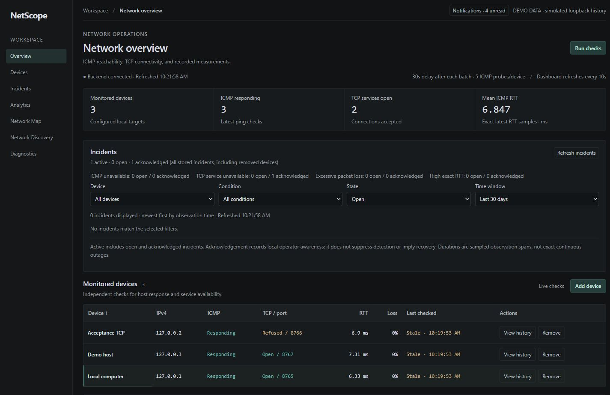
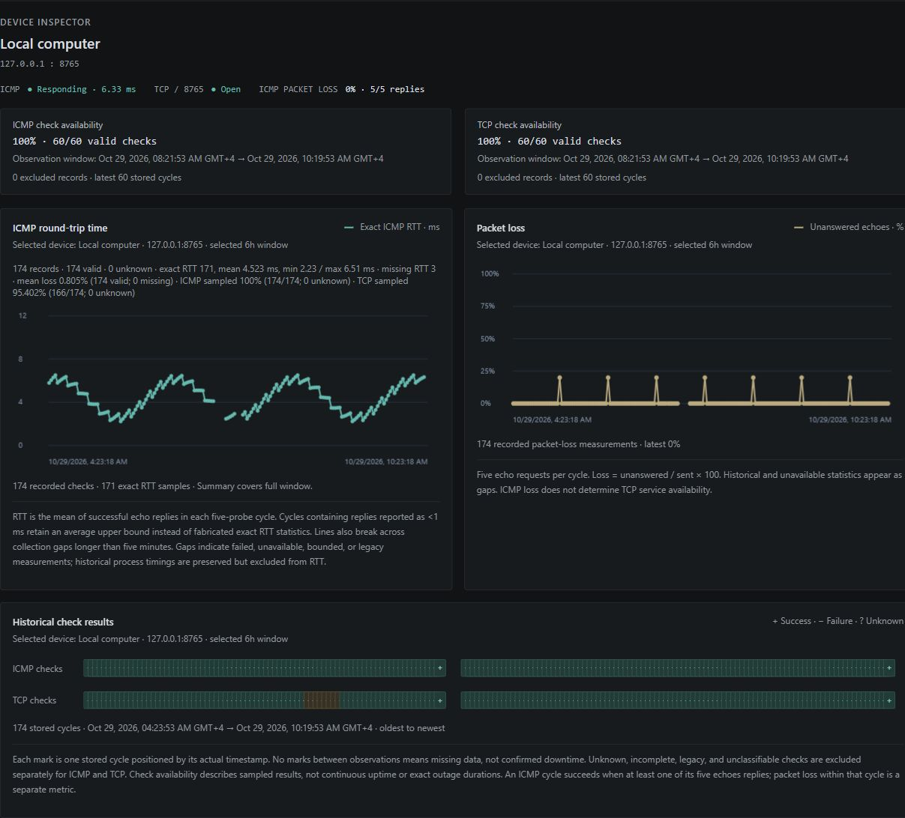
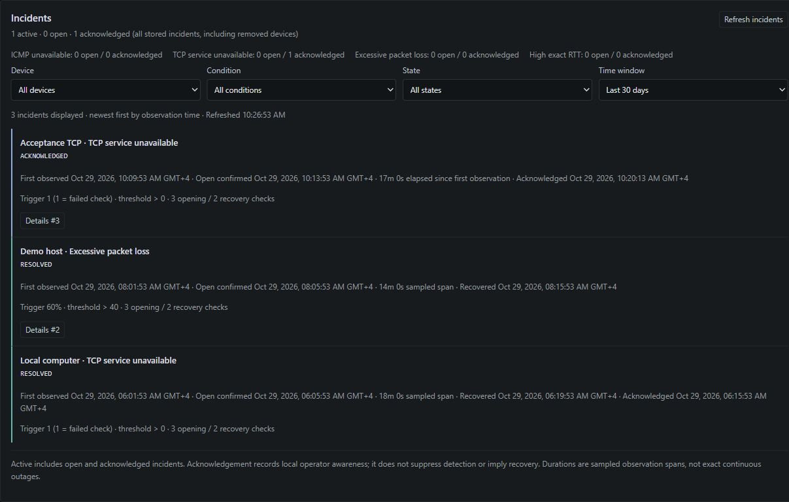
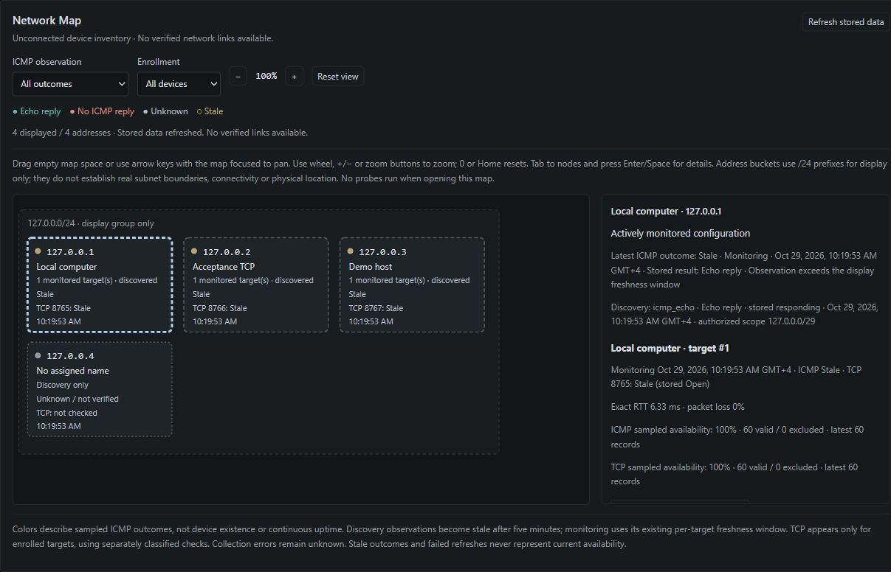
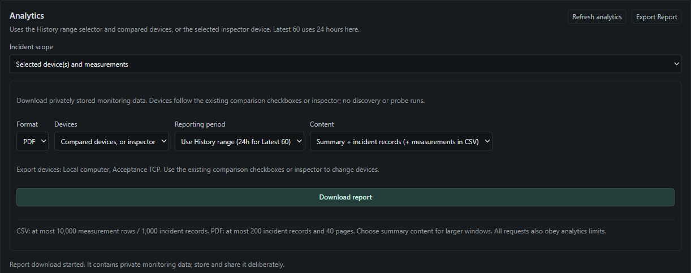
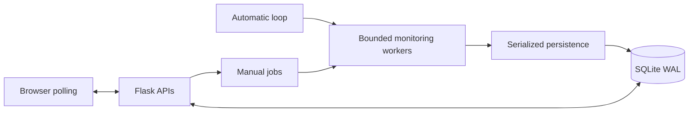

# NetScope

**Full-Stack Network Observability & Incident Management System**

A local Windows application for monitoring network checks, investigating incidents, and exploring stored measurements.


[](LICENSE)



*Current application UI, captured with simulated observations in a disposable loopback-only database. All screenshots were individually privacy-reviewed; they are demonstrations, not live network measurements.*

## Overview

NetScope brings device monitoring, incident investigation, and historical reporting into one browser dashboard. It records ICMP reachability and TCP service connectivity independently, preserving failed, unknown, and bounded observations rather than hiding uncertainty. Built as a portfolio project, it demonstrates a complete path from concurrent network work through transactional persistence and API design to an interactive frontend. Data stays in a local SQLite database; no cloud account or database server is needed.

## Key features

- **Concurrent monitoring:** five ICMP echoes and an independent TCP check per device, with bounded workers and overlap protection.
- **Automatically updating dashboard:** ten-second polling, sortable inventory, and asynchronous manual checks with progress feedback.
- **Incident lifecycle:** consecutive-check thresholds, acknowledgement notes, verified recovery, and persistent in-app opened/resolved notifications with read controls.
- **Historical analytics:** time-range charts, missing-data gaps, two-to-four-device comparisons, sampled availability, and exact RTT statistics including percentiles.
- **Authorized discovery and map:** explicit per-scan consent, at most 32 usable private/loopback IPv4 hosts, deliberate enrollment, and an interactive inventory map without invented topology links.
- **CSV/PDF reporting:** device/date/content selection, bounded exports, and spreadsheet-safe escaping of user-controlled text.

Manual DNS and Windows traceroute tools are also implemented. See the [full feature and API reference](docs/REFERENCE.md) for behavior, definitions, and limits.

## Screenshots

Click a capture to view it at full size.

These captures use the same privacy-reviewed, simulated demo dataset as the hero. The map shows stored observations and freshness, not physical network connections. Report controls show a demo download-started state; diagnostics results and PDF page layout are not claimed as verified by these images.

<table>
  <tr>
    <td width="50%" valign="top">
      <strong>Monitoring history</strong><br>
      <a href="docs/screenshots/02-device-history.png"></a>
      <p>Time-based charts preserve missing and bounded measurements.</p>
    </td>
    <td width="50%" valign="top">
      <strong>Incident investigation</strong><br>
      <a href="docs/screenshots/03-incidents.png"></a>
      <p>Review resolved incidents alongside acknowledged active conditions.</p>
    </td>
  </tr>
  <tr>
    <td width="50%" valign="top">
      <strong>Network inventory map</strong><br>
      <a href="docs/screenshots/07-network-map.png"></a>
      <p>Inspect stored device details, independent checks, and stale states.</p>
    </td>
    <td width="50%" valign="top">
      <strong>Report exports</strong><br>
      <a href="docs/screenshots/10-reporting-export.png"></a>
      <p>Select devices, a reporting period, and report content.</p>
    </td>
  </tr>
</table>

Browse the [complete gallery and privacy/provenance report](docs/screenshots/README.md) for notifications, incident details, discovery inventory, statistics, comparisons, and diagnostics.

## Architecture & tech stack

Flask serves the APIs and dashboard. The automatic monitoring loop and manual background jobs share a bounded coordinator: workers collect measurements, then the coordinator serializes SQLite writes. Incident evaluation follows committed measurements; transition events persist transactionally. The frontend polls APIs and renders stored results.



**Stack:** Python, Flask/Werkzeug, SQLite, vanilla JavaScript, HTML/CSS, Canvas/SVG charts, and ReportLab PDFs. Tests use Python `unittest`, pypdf, and Node's built-in test runner. See the [architecture guide](docs/ARCHITECTURE.md) for transactions, thread ownership, and module boundaries.

## Quick start

Use Windows x64 with Python 3.10 installed; the verified interpreter baseline is **CPython 3.10.7**. From the cloned or extracted project root, run in PowerShell:

```powershell
py -3.10 --version
py -3.10 -m venv .venv
.\.venv\Scripts\python.exe -m pip install -r requirements.lock.txt
.\.venv\Scripts\python.exe -m pip check
.\.venv\Scripts\python.exe app.py
```

Open [127.0.0.1:5000](http://127.0.0.1:5000). A fresh database starts with **Local computer**, `127.0.0.1:80`; a closed TCP port can coexist with successful ICMP. Stop normally with **Ctrl+C**. No environment activation, npm install, or execution-policy change is required.

Run one local process using this launcher, with debug/reloader disabled. Monitor only authorized private/loopback IPv4 targets. There is **no authentication or supported remote deployment**: do not expose the server through a public bind, proxy, or tunnel. See [setup and configuration](docs/CONFIGURATION.md) before changing storage or upgrading an existing database.

## Testing & status

**Portfolio preview — not production-ready.** The latest completed regression run passed **261 Python tests and 91 frontend tests** using disposable storage (29 October 2026). Node.js **24.14.1** was verified for development checks; it is not a runtime requirement.

Owner-confirmed manual checks cover Windows startup, monitoring, restart persistence, incident opening/acknowledgement/recovery, and in-app notification controls. Full historical analytics, separately authorized real discovery/map testing, report downloads/PDF visual acceptance, and responsive/accessibility acceptance remain incomplete. Sampled availability is not continuous uptime, and ordinary history has no automatic retention. Fresh upstream dependency provenance and vulnerability certification were not established.

Use the [release checklist](docs/RELEASE_CHECKLIST.md) for exact test commands and recorded evidence, and [final acceptance](docs/FINAL_ACCEPTANCE.md) for remaining manual gates. No CI/build-success badge is claimed.

## Documentation & license

- [Architecture](docs/ARCHITECTURE.md) — components, concurrency, and persistence.
- [Features and API reference](docs/REFERENCE.md) — workflows, endpoints, metrics, limits, and benchmarks.
- [Setup and configuration](docs/CONFIGURATION.md) — Windows compatibility, storage, and environment settings.
- [Screenshot gallery](docs/screenshots/README.md) — all 12 captures and privacy review.
- [Release checklist](docs/RELEASE_CHECKLIST.md) · [Manual acceptance](docs/FINAL_ACCEPTANCE.md) — reproducibility and verification boundaries.

[MIT License](LICENSE) · Copyright (c) 2026 Sanad Nawayseh. Third-party dependencies retain their respective licenses.
