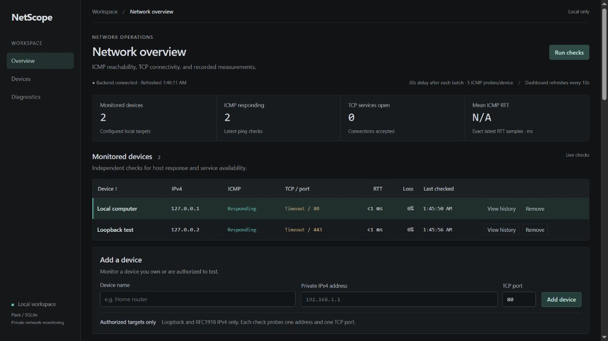
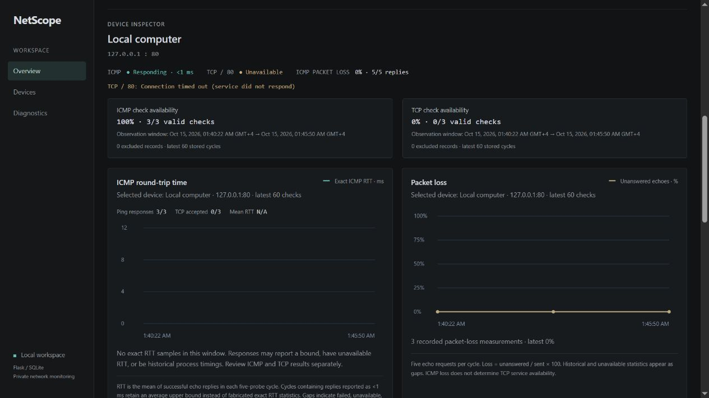
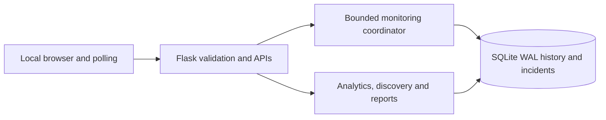

# NetScope

A local-first network monitoring and diagnostics platform built with Python, Flask, SQLite and vanilla JavaScript. NetScope records independent ICMP/TCP observations, explains uncertain results, and keeps monitoring data on your machine.

Monitor only systems you own or are explicitly authorized to test. The documented deployment is a **single local process on `127.0.0.1:5000`**, not an authenticated remote service or enterprise monitoring system.

## Features

| Area | Implemented behavior |
| --- | --- |
| Monitoring | Five ICMP echoes and an independent TCP check per device, bounded concurrent workers, automatic scheduling, async manual jobs and progress. |
| Data reliability | SQLite WAL, foreign keys, additive versioned migrations (schema 5), validation and persistent measurement history. |
| History | Timestamp-based RTT/loss/check charts, 1h–30d ranges and 2–4 device comparisons. Unknown/bounded RTT remains unavailable. |
| Incidents | Persistent ICMP/TCP unavailability, excessive loss and high exact RTT conditions; consecutive-check thresholds, acknowledgement and verified recovery. |
| Notifications | Durable opened/resolved events, unread/read controls and optional browser desktop alerts while the page is open. |
| Authorized discovery | Explicit per-scan consent, private/loopback IPv4 CIDRs, at most 32 usable hosts, bounded jobs/cancellation and separate inventory. |
| Network Map | Interactive unconnected SVG inventory with status, freshness, filters, pan/zoom and details. Display address buckets are not verified topology. |
| Analytics | Exact cycle RTT mean/median/p95/p99, loss distributions, separate sampled availability, preceding-window trends and incident statistics. |
| Reports | Local on-demand CSV/PDF exports with content/date/device selection, safe spreadsheet escaping and bounded generation. |
| Diagnostics | Manual public-domain DNS lookup and explicitly authorized Windows traceroute; no automatic enrollment from diagnostic results. |

Full metric definitions, API contracts, retention and size limits are in the [feature/API reference](docs/REFERENCE.md).

## Authentic screenshots

These are genuine October 15, 2026 captures from a disposable **loopback-only** setup. They show the earlier inventory/inspector, not the newer incidents, map, analytics or export UI. They have not been replaced with mockups.





Current screenshots still need manual capture during authorized final testing: incidents/notifications, discovery consent/progress, Network Map, advanced analytics and exports. Follow the [privacy and capture checklist](screenshots/README.md).

## Architecture



The [architecture document](docs/ARCHITECTURE.md) maps the actual modules, threads, transactions, notification triggers and failure boundaries. Probe workers return results; a coordinating thread serializes SQLite writes. Incident evaluation follows measurement commit in a separate retryable transaction. Reports reuse analytics, and discovery has a separate pool with shared admission limits.

## Verified requirements

| Component | Verified baseline |
| --- | --- |
| OS | Windows x64; Windows `ping.exe` and `tracert.exe`. |
| Python | CPython **3.10.7** (runtime and a fresh isolated virtual environment). |
| Node.js | **24.14.1**, used only for frontend tests/syntax checks. No npm install is needed to run NetScope. |
| Browser | A modern browser with JavaScript/Canvas/SVG; Notification API is optional. Manual cross-browser/mobile/assistive-technology acceptance remains pending. |
| Database | SQLite supplied by Python; no database server. |

This is the verified compatibility baseline, not a claim that other Python/Node versions or Linux/macOS were tested. Additional patched interpreter/OS versions should be verified before expanding release support. Non-Windows ping branches exist, but traceroute is Windows-only and localized command output may be unknown/unparseable.

Runtime packages are Flask, Werkzeug and ReportLab plus transitive dependencies. Development adds pypdf for PDF assertions; frontend tests use Node's built-in runner. There are no runtime cloud services, graph frameworks or charting dependencies.

## Windows installation

Open PowerShell in the extracted/cloned project root (the directory containing `app.py`). Install the verified Python and, for development only, Node baseline first.

```powershell
py -3.10 --version
py -3.10 -m venv .venv
.\.venv\Scripts\python.exe -m pip install -r requirements.lock.txt
.\.venv\Scripts\python.exe -m pip check
.\.venv\Scripts\python.exe app.py
```

Activation and execution-policy changes are unnecessary. Open [http://127.0.0.1:5000](http://127.0.0.1:5000), or the matching localhost address, and use that same origin. Press Ctrl+C to stop normally. Do not use `flask run`, a reloader, multiple worker processes, a tunnel or a public bind as a substitute for this launcher.

The launcher configures console/rotating logs, initializes a fresh database or safely migrates a compatible existing database, starts automatic monitoring, then serves the dashboard. A new database seeds **Local computer**, `127.0.0.1`, TCP port 80. A closed port is a valid negative TCP result even when ICMP answers. Existing devices/history and intentionally empty inventories are preserved; incompatible/unknown schemas fail startup rather than reset data. Back up private data before upgrading; no downgrade/repair tool is provided.

Exact direct/transitive versions are pinned in [runtime](requirements.lock.txt) and [development](requirements-dev.lock.txt) lock files. The existing [runtime ranges](requirements.txt) and [development ranges](requirements-dev.txt) remain maintenance inputs; use the locks for the verified snapshot. Pins are not package hashes, a vulnerability audit or verification of every supported platform. The clean-install check uses an offline wheelhouse derived from the configured installed packages; a fresh Internet/PyPI retrieval was not part of that check.

## Configuration

Set supported environment variables before startup, for example:

```powershell
$env:NETSCOPE_DB = Join-Path $PWD 'private-data\netscope.db'
$env:NETSCOPE_MONITOR_WORKERS = '4'
$env:NETSCOPE_CHECK_INTERVAL = '30'
$env:NETSCOPE_INCIDENT_OPEN_CHECKS = '3'
$env:NETSCOPE_INCIDENT_RECOVERY_CHECKS = '2'
$env:NETSCOPE_INCIDENT_LOSS_PCT = '40'
$env:NETSCOPE_INCIDENT_LATENCY_MS = '200'
$env:NETSCOPE_LOG_LEVEL = 'INFO'
.\.venv\Scripts\python.exe app.py
```

[Configuration reference](docs/CONFIGURATION.md) lists every supported variable, accepted bounds, timeouts and log rotation. Invalid settings stop startup. Alert settings persist in SQLite: explicit overrides update them; removing an override retains the stored setting. `.env` is ignored for privacy but is **not automatically loaded**.

## Use NetScope

1. Start with loopback, then add only an authorized private/loopback IPv4 target and a deliberate TCP port. Do not assume an open web service.
2. Read ICMP and TCP independently. Use **Run checks** for a nonblocking monitoring job; busy requests return 409. The dashboard normally refreshes every ten seconds.
3. Select a device for history, choose a range, or select comparison checkboxes. Exact RTT charts leave gaps for `<1 ms`, failed and unknown measurements. Sampled availability is not continuous uptime.
4. Review **Incidents**, filter timelines and acknowledge OPEN incidents when appropriate. Acknowledgement records awareness, not recovery. Stored recovery requires qualifying valid observations.
5. Open **Notifications** for durable events/read controls. Enable desktop alerts only through its preference button; denial does not disable in-app notifications. No alerts are delivered with the page closed.
6. Open **Network Discovery** only for an explicitly authorized, exact CIDR. Confirm consent for each scan. Discovery never starts from page loads and never automatically enrolls targets. Only a deliberate enrollment action schedules future monitoring.
7. Use **Network Map** to inspect stored devices. No links are drawn because there is no verified link evidence. An ICMP nonreply does not prove a device is absent.
8. Use **Analytics** and **Export Report** for bounded historical summaries or private CSV/PDF downloads. Choose a shorter window/summary content if limits are exceeded.
9. DNS/traceroute are separate manual tools. DNS never connects to returned addresses; traceroute requires permission for the destination.

## Tests and reproducibility

From the project root:

```powershell
.\.venv\Scripts\python.exe -m pip install -r requirements-dev.lock.txt
.\.venv\Scripts\python.exe -B -m unittest discover -s tests -v
node --test --test-isolation=none tests/test_dashboard.cjs
Get-ChildItem static\*.js | ForEach-Object { node --check $_.FullName }
.\.venv\Scripts\python.exe -m pip check
git diff --check
```

For a fresh temporary environment and launcher/migration check:

```powershell
.\.venv\Scripts\python.exe -B tools/verify_install.py
```

The verifier rebuilds a private wheelhouse from installed locked distributions, installs runtime then development packages into a new virtual environment with system-site-packages disabled, checks dependencies, exercises the launcher with mocked probes/HTTP serving against fresh and legacy temporary databases, then runs all Python tests. It performs no discovery and never selects the real user database. It verifies offline package installation/isolation, not upstream artifact provenance. Detailed scope and manual checks are in the [release checklist](docs/RELEASE_CHECKLIST.md).

Tests use simulated observations and disposable databases; original socket/ICMP regression tests exercise self-owned loopback only. Frontend tests simulate DOM/Canvas/SVG and downloads; they do not replace real browser/OS acceptance. Benchmarks are optional, simulated and temporary:

```powershell
.\.venv\Scripts\python.exe -B tests/benchmark_monitoring.py --repeats 5
.\.venv\Scripts\python.exe -B tests/benchmark_analytics.py
.\.venv\Scripts\python.exe -B tests/benchmark_reports.py
```

Current release-preparation verification results are recorded in the [release checklist](docs/RELEASE_CHECKLIST.md). [AUDIT.md](AUDIT.md) is a historical source/behavior audit, not certification of the current release.

Release-preparation verification: **260 Python tests passed in a clean temporary environment (72.232s)**; **91 frontend tests passed (1.769s)**. Runtime/test lock installation, simulated fresh/legacy launcher checks, dependency integrity, syntax, local documentation links and both Mermaid parses passed. This does not replace the manual acceptance tasks below.

## Security and limitations

- Loopback access and matching Host/Origin are mandatory; there is no authentication, TLS deployment, multi-user authorization or safe remote-hosting design. Trusted local tools can mutate data. Do not expose the Flask development server to other hosts.
- Monitoring/discovery/traceroute allow literal RFC1918 and loopback IPv4 only. No public, IPv6, link-local or unrestricted scans. Private scope alone is not proof of permission. Discovery is limited to 32 usable hosts, two workers and explicit per-scan consent.
- ICMP filtering, TCP refusal and software failures have different meanings. Unknown results do not become network outages. Exact RTT statistics never manufacture values from bounds. Incident spans include sampling gaps/confirmation delays and are not exact physical downtime.
- Jobs are process-local, bounded and lost on restart; failed measurement writes are not automatically replayed. Graceful shutdown drains started bounded work, while forced termination can lose it. Multi-process coordination is unsupported.
- Monitoring, incident and notification storage has no automatic retention policy. Discovery retains 2,048 observations. Charts, query budgets, map pages and reports are bounded; see the [reference](docs/REFERENCE.md) for exact limits.
- DNS can use OS caches/hosts/resolvers and cannot safely cancel an OS resolver thread. Traceroute depends on Windows/locale/routing policies. Neither establishes physical topology or complete device enumeration.
- PDFs use bundled fonts with visible Unicode escape fallbacks for unsupported glyphs. CSV formula safety deliberately prefixes risky text. Exports, notes, databases and custom logs can contain private data and need local access controls/backups.
- Existing screenshots are authentic but outdated. Actual desktop alert delivery, browser downloads, touch/mobile/keyboard/screen-reader acceptance and separately authorized discovery still require manual final testing.

## Repository and license

Application modules remain at the root; frontend assets are in `static/`, templates in `templates/`, tests/benchmarks in `tests/`, and release documentation in `docs/`. Databases/sidecars, environments, logs, reports/exports, CSV/PDF files, caches and private/raw data folders are ignored. Reviewed screenshots remain version controlled. Ignore rules do not remove already-tracked secrets; review staged content before publication.

No license has been selected. **MIT is recommended as an option**, but no LICENSE file or licensing grant is added without the owner's decision. Dependency licenses remain their respective owners'.

Before publication, complete the [release checklist](docs/RELEASE_CHECKLIST.md): choose a license, review private data and dependency provenance, capture genuine current screenshots, and finish manual OS/browser testing. Containers, CI/CD and remote deployment are optional future work, not included or claimed here.
