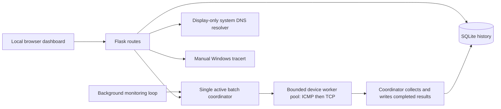

# NetScope

A student-built network monitoring and diagnostics project for a computer engineering portfolio. NetScope combines a local Flask dashboard, independent ICMP and TCP checks, and persistent SQLite measurements to help explain what a network check can—and cannot—tell you.

The dashboard uses real backend results. There are no simulated production measurements. This is a local, single-user learning tool for systems you own or have permission to test.

## Features

| Area | Implemented behavior |
| --- | --- |
| Device monitoring | Add named loopback/private IPv4 devices and a TCP service port; view independent checks in a compact, sortable dark-mode device table. |
| ICMP | Five Echo Requests per device per cycle; parse actual ping replies and completed batch statistics. |
| Packet loss | Sent, received, unanswered, and percentage lost within each completed five-probe cycle. |
| RTT | Reply-derived average/minimum/maximum RTT; preserve `<1 ms` bounds and show unavailable measurements as N/A. |
| TCP | Independent connection checks with distinct refusal, timeout, network-error, and unavailable diagnostics. |
| History | SQLite-backed latency and packet-loss charts, device selection and history navigation, empty/loading/error states. |
| Availability | Separate ICMP and TCP check availability summaries with valid/excluded sample counts, observation windows, and a success/failure/unknown timeline. |
| DNS | Manual, display-only system resolver lookup of public domain names; show available IPv4/IPv6 results, duration, and explanatory errors. |
| Traceroute | Manual Windows `tracert -d -4` to an explicitly authorized private/loopback destination; three measurements per hop and reached/incomplete/failure states. |
| Safeguards | Strict destination validation, bounded commands and inputs, local browser request boundary, diagnostic rate limits, and prevention of overlapping monitoring batches. |

## Screenshots

These are genuine captures from an isolated loopback-only preview using real SQLite records and ping/TCP results. Unavailable exact RTT remains N/A; the interface does not manufacture numerical samples. See [screenshots/README.md](screenshots/README.md) for provenance and the capture/privacy checklist.


## Technologies

- Python 3.10+; Flask for routes/templates and Werkzeug for HTTP errors.
- Python standard library: SQLite, sockets, subprocesses, IP validation, threading, and unit tests.
- HTML, CSS, and vanilla JavaScript with Canvas charts; no frontend framework or chart dependency.
- Windows system `ping.exe` and `tracert.exe`.
- Node.js built-in test runner for frontend regression tests; Node is optional for running the app.

`requirements.txt` lists the two directly imported third-party Python packages. Their transitive dependencies are installed by pip. SQLite is included with Python; no database server or npm installation is required.

## Architecture



`app.py` owns validation, measurement collection/persistence, availability classification, and routes. `monitoring_coordinator.py` owns the bounded executor, batch admission, completed-result collection, and shutdown. `dns_diagnostics.py` and `traceroute_diagnostics.py` isolate manual diagnostics. Neither diagnostic automatically runs during monitoring or writes lookup/trace results to the monitoring database.

A monitoring thread coordinates one batch at a time. Up to **4 devices** are checked concurrently by a `ThreadPoolExecutor` (configurable 1–16). Each device still runs five ICMP probes followed by its independent TCP check. Worker threads never use SQLite: the thread coordinating the batch writes completed measurements one at a time using short, separate transactions. The executor queues the current target snapshot; it does not queue additional monitoring batches.

The original process-local batch lock covers target snapshot loading, all futures, and persistence. Competing checks return busy rather than queueing another batch; device changes remain blocked until results have settled, preventing target deletion/ID reuse races. The configured interval is a delay **after** the batch finishes, so the actual sampling period includes probe and persistence time. The browser continues polling every 10 seconds.

`collect_measurement()` and `persist_measurement()` separate probes from writes. `run_check()` remains a compatible single-target collection/persistence wrapper. Completed negative network results keep their existing meanings. Unexpected protocol errors preserve the other protocol's measurement and become unknown/unavailable, excluded from the relevant availability denominator. Useful partial rows can be saved while the batch reports execution failure (HTTP 503). Whole-task failures, cancelled unstarted work, and failed database inserts do not create synthetic offline records. Persistence is attempted once per outcome; a failure is logged and counted without replaying an uncertain insert.

On normal server exit or Ctrl+C, the launcher signals stop, rejects new batches, cancels queued work, allows already-started bounded probes to finish, persists available results, and joins monitoring/executor threads. It does not hold lifecycle locks while waiting. Python cannot kill a running worker thread safely; shutdown can take the remaining probe deadlines plus SQLite waits. Forced process termination can lose in-flight work. A stopped coordinator is terminal; restart the application to resume.

SQLite stores targets and timestamped results, uses WAL mode and parameterized request values, and applies additive migrations for older databases. History responses and availability summaries cover the latest **60 stored rows per device**, with history returned chronologically. Older rows remain stored.

Schema version 1 is tracked with SQLite `PRAGMA user_version`. Startup upgrades fresh and compatible unversioned (version 0) databases, including partially applied historical column additions, in an explicit transaction. Existing rows are preserved; only a fresh database receives the default target. Schema changes, the version update, and seeding commit together or roll back together. Unknown versions, incompatible schemas, and foreign-key violations stop initialization rather than resetting data. WAL configuration occurs before the migration transaction and is not rolled back. Downgrades and automatic repair are not supported.

New measurements are validated before insertion: flags must be 0/1, timestamps timezone-aware, RTT values finite and nonnegative, and completed packet counts/loss internally consistent. Unknown measurements may retain null statistics. This application safeguard does not rewrite legacy history or add table constraints; direct SQLite writes can bypass it. Startup also verifies foreign-key enforcement and the history index definition.

```text
netscope_starter/
├── app.py
├── monitoring_coordinator.py
├── dns_diagnostics.py
├── traceroute_diagnostics.py
├── requirements.txt
├── templates/index.html
├── static/
│   ├── app.js
│   └── style.css
├── tests/                    # Python and JavaScript regression tests
├── screenshots/              # Capture instructions and empty category folders
├── AUDIT.md                  # Preserved technical audit
├── README.md
└── .gitignore
```

The runtime database and virtual environment are deliberately absent from the publication tree.

## Windows setup

Prerequisites: Windows, Python 3.10 or later with the Python launcher, and a browser. Windows provides the ping and traceroute commands. Git is useful for cloning but is not an application dependency.

In PowerShell, open the project directory and run:

```powershell
py --version
py -m venv .venv
.\.venv\Scripts\python.exe -m pip install -r requirements.txt
.\.venv\Scripts\python.exe app.py
```

These commands use the virtual environment directly; activation and changes to PowerShell execution policy are unnecessary. Paste `http://127.0.0.1:5000` into the browser address bar. Press Ctrl+C in the terminal to stop the application.

The supplied entry point binds only to `127.0.0.1:5000`, with debug mode and the reloader disabled. Use this entry point so database initialization and the background thread run. Do not expose it through a public binding, tunnel, proxy, or multiple worker processes.

A new database seeds **Local computer**, `127.0.0.1`, TCP port 80. A closed port 80 is a legitimate TCP refusal even when localhost answers ping. Existing databases retain their device list and history; intentionally empty device lists stay empty on restart.

### Configuration

Set environment variables before starting the application:

| Variable | Default | Meaning / supported range |
| --- | --- | --- |
| `NETSCOPE_DB` | `netscope.db` beside `app.py` | Local SQLite path; keep the database and sidecar files private. |
| `NETSCOPE_CHECK_INTERVAL` | `30` | Seconds between completed batches; 1–3600. |
| `NETSCOPE_ICMP_TIMEOUT_MS` | `1000` | Per-probe ICMP wait in milliseconds; 100–10000. |
| `NETSCOPE_TCP_TIMEOUT` | `1.5` | TCP connection timeout in seconds; 0.1–30. |
| `NETSCOPE_MONITOR_WORKERS` | `4` | Integer device-worker limit; 1–16. Use 1 for sequential fallback. |

For example:

```powershell
$env:NETSCOPE_CHECK_INTERVAL = '30'
$env:NETSCOPE_ICMP_TIMEOUT_MS = '1000'
$env:NETSCOPE_TCP_TIMEOUT = '1.5'
$env:NETSCOPE_MONITOR_WORKERS = '4'
.\.venv\Scripts\python.exe app.py
```

There are always five ICMP requests per monitoring cycle. The ping subprocess also has an overall deadline. Invalid timeout/interval/worker configuration stops startup rather than silently using unsafe values.

## Usage

### Local application logs

The supplied `python app.py` launcher writes JSON lines to the console and `logs/netscope.log` beside the application. Application and Werkzeug server records use the same privacy-conscious formatter. Each record includes UTC time, severity and an event type; monitoring batches also include a random batch identifier, elapsed milliseconds and result counts where applicable. Unexpected probe and database failures are errors; completed batches with execution failures are warnings. Expected network refusals/timeouts remain measurement results and do not generate per-device application errors.

| Variable | Default | Meaning |
| --- | --- | --- |
| `NETSCOPE_LOG_LEVEL` | `INFO` | `DEBUG`, `INFO`, `WARNING`, `ERROR`, or `CRITICAL`. |
| `NETSCOPE_LOG_DIR` | `logs` beside `app.py` | Local output directory; keep it private. |
| `NETSCOPE_LOG_MAX_BYTES` | `1048576` | Rotation threshold in bytes; 1024–104857600. |
| `NETSCOPE_LOG_BACKUPS` | `3` | Retained rotated files; 1–20. |

Rotation retains the active file plus the configured number of numbered backups. Invalid configuration or an unwritable log directory stops startup. Logging is configured by the launcher, not by importing application modules. The formatter omits raw messages, request URLs/bodies, target names/addresses, database paths/rows, exception messages and traceback text; exceptions retain their class name. This deliberately limits debugging detail. Use event types, batch identifiers and failure phases to correlate events. Generic server/framework messages appear as `application_message`. Raising the minimum log level suppresses lower-severity lifecycle events. Default `logs/` is Git-ignored; custom output locations must be kept out of publication.

### Dashboard workflow

1. Start with the preloaded localhost device. Wait for the first monitoring cycle, or request a manual check.
2. Add another device only if you own it or have explicit permission. Enter a descriptive name, a literal RFC1918/loopback IPv4 address, and the specific TCP port you want to check. Do not assume a router has an open web port.
3. Read the ICMP and TCP rows independently. A filtered ping or refused TCP connection does not establish that the whole device is offline.
4. Select a device name or click **View history** in its table row. The dashboard selects that device, displays its name/IP, loads stored measurements, and moves to its history charts. A new device can legitimately have no history yet. Click a column heading to sort ascending/descending. IP addresses, exact RTT, packet loss, and timestamps sort numerically; unavailable/bounded RTT values stay after exact samples. On smaller screens, the inventory scrolls horizontally while detail panels stack vertically.
5. In Diagnostics, enter a public domain such as `example.com` for a manual system DNS lookup. Results depend on your actual resolver; no particular address or address family is guaranteed.
6. For traceroute, enter an authorized private/loopback IPv4 destination, choose a hop limit, and confirm permission for that destination. Selecting a device prefills its address when no trace is active and clears prior permission; this never starts a trace automatically. A `*` means a probe received no reply within its wait, not proof of an intermediate router outage.

Adding/removing devices or requesting another batch while monitoring is active can return a busy message (HTTP 409). **Run checks** submits an asynchronous job and polls its status about once per second, refreshing device/history data as tasks settle. The button stays disabled while that job is tracked; its status is announced through a keyboard-accessible live region. Transient status-request failures retry without submitting another batch. Terminal states stop job polling; ordinary dashboard polling continues every 10 seconds. Submission/status requests have a 10-second browser wait, independent of the batch duration. A lost submission response may leave a running job; it is never automatically resubmitted. Disconnecting does not cancel server work or release the batch lock.

The legacy `/api/check` endpoint and Python `check_all()` remain synchronous for compatibility and retain their existing response fields/status codes. Their old HTTP wait limitations still apply. Removing a device also deletes its associated history through the existing database relationship; keep a private backup if you need those records.

### Historical time ranges and comparison

Use **History range** for the last 1 hour, 6 hours, 24 hours, 7 days or 30 days. The default Latest 60 records keeps the original inspector/history API behavior. Select two to four devices in **Compare devices** to overlay exact RTT and packet loss on common time/measurement axes, with separate ICMP/TCP sampled-check dots. Device colors match numbered textual summaries; ICMP uses circles and TCP squares. Comparison defaults to 24 hours when Latest 60 is selected. Regular dashboard polling and manual-job updates refresh active histories and comparisons without reloading the page.

Chart and timeline positions represent actual elapsed time. Lines break at missing/unknown values and collection gaps over five minutes; this is a display threshold, not an outage detector. Bounds such as `<1 ms` never become numerical RTT points. Availability dots represent individual successful/failed observations; missing dots and unknown checks do not establish downtime or continuous uptime. Timestamp labels include the date in the browser's local timezone; API windows are UTC. Duplicate timestamps can overlap visually. Slow sampling intervals over five minutes intentionally display isolated dots.

Per-device range summaries cover **all matching records**, even when the plotted records are capped. They include record/valid/unknown counts; exact per-cycle RTT sample count, mean/min/max and missing RTT count; mean packet loss with valid/missing counts; and separate ICMP/TCP sampled availability denominators and exclusions. A record is valid if at least one protocol is classifiable. Missing RTT includes failed, bounded, legacy and invalid readings. The existing device-list/inspector availability cards still explicitly cover their latest 60 stored rows.

`GET /api/history?targets=1,2&range=6h` returns `{start, end, point_limit, series}`. Each series contains `{target_id, name, points, summary, truncated, returned_points}`. At most four distinct positive device IDs and one supported range are accepted; malformed/duplicate parameters return 400 and nonexistent devices return 404. All devices share one read snapshot and exact start/end window. SQL values are parameterized and records are ordered by SQLite `julianday(checked_at)` with ID as a tie-breaker, so insertion order and timezone offsets do not distort ordering.

`GET /api/targets/1/history?range=6h` also supports a bounded, timestamp-ordered array for compatibility with array clients. Without parameters it still returns the latest 60 inserted rows exactly as before. Use `/api/history` for full-window summaries and explicit truncation metadata. The dashboard uses that summary endpoint when a time range is selected.

Payloads include only the **newest 2,000 rows per device**, without interpolation or invented bucket averages. A visible truncation notice identifies this chart subset; older parts of the selected window may therefore be blank even while their observations contribute to summaries. Malformed timestamps cannot be assigned to a time window and are excluded; timezone-naive rows that SQLite can place in the window are counted as invalid timestamps and have unknown protocol states. Custom start/end dates are deferred.

Startup adds the optional `idx_results_observed` expression index on device ID, guarded Julian timestamp, and record ID after schema validation; tables, existing rows and schema version 1 remain unchanged. Only timestamps starting with a four-digit year and hyphen are converted, so SQLite aliases such as legacy text `now` remain stored without causing non-deterministic-index errors. This requires SQLite expression-index support (SQLite 3.9+, included in the supported Python environment). The first initialization builds the index over existing history and needs disk space/time proportional to history size. Summaries stream matching rows with bounded memory; work scales with the selected window's record count. A ten-second analysis budget returns a safe 503 for unusually large/slow queries; choose fewer devices or a shorter range. Long WAL read snapshots can delay checkpoint reclamation during analysis. No retention, deletion, or automatic database reset is introduced.

### Reading individual measurements

**Packet loss** describes one completed ICMP cycle:

```text
packet loss = unanswered Echo Requests / 5 × 100
```

For example, three successful Echo Replies out of five requests means 40% packet loss. Windows destination-unreachable messages are not counted as successful Echo Replies. A malformed/incomplete batch produces unavailable loss statistics, not invented 100% loss.

**RTT** is the time reported by an Echo Reply, not the time spent launching the ping process. Missing replies never contribute zero milliseconds. Exact cycle RTT statistics require usable exact RTTs for all successful replies. If replies include a bound such as `<1 ms`, the app preserves a bound instead of inventing an exact mean; these cycles are not plotted as exact numerical latency. A completed cycle with no successful replies has no RTT.

**Check availability** compares completed, classifiable checks across the displayed history window:

```text
ICMP check availability = successful ICMP cycles / valid completed ICMP cycles × 100
TCP check availability  = successful TCP connections / valid completed TCP checks × 100
```

An ICMP cycle succeeds when at least one Echo Reply is received. Thus, a cycle can have partial packet loss and still be a successful ICMP check. Each protocol has its own denominator; unknown, incomplete, unclassifiable, and legacy results are excluded as appropriate. Every percentage includes sample counts and its qualifying observation window. No valid samples means N/A. These metrics are polling observations, not continuous uptime or exact outage durations.

### Local API reference

Requests must originate through the local dashboard boundary. JSON mutations can also be made from local tools with the correct Host and no foreign Origin.

| Method | Endpoint | Purpose |
| --- | --- | --- |
| GET | `/api/targets` | Devices, latest results, and availability summaries. |
| POST | `/api/targets` | Add `{ "name": "Local test", "ip": "127.0.0.1", "port": 80 }`. |
| DELETE | `/api/targets/<id>` | Remove a device and its history. |
| GET | `/api/targets/<id>/history` | Up to 60 stored measurements, oldest to newest within that window. |
| POST | `/api/check` | Legacy synchronous batch; report completed/failed counts. |
| POST | `/api/check-jobs` | Reserve the existing coordinator and return HTTP 202 plus job status and a `Location` header. No request body required. |
| GET | `/api/check-jobs/<job_id>` | Read a retained job snapshot; HTTP 404 if unknown, evicted or lost on restart. |
| POST | `/api/dns` | Lookup `{ "domain": "example.com" }`. |
| POST | `/api/traceroute` | Trace `{ "ip": "127.0.0.1", "authorized": true, "max_hops": 12 }`. |

Read-only example in PowerShell:

```powershell
Invoke-RestMethod -Uri 'http://127.0.0.1:5000/api/targets'
```

### Manual monitoring job lifecycle

An accepted submission returns HTTP 202, for example:

```json
{"job_id":"f73a1f3b36aa4d09a1fb518a882ccf11","state":"queued","total":0,"completed":0,"failed":0,"progress_percentage":0,"started_at":null,"ended_at":null,"error":null}
```

The background runner may already have changed the returned state to running or terminal before the HTTP response arrives. Poll the `Location` header, such as `/api/check-jobs/f73a1f3b36aa4d09a1fb518a882ccf11`. A settled snapshot can look like:

```json
{"job_id":"f73a1f3b36aa4d09a1fb518a882ccf11","state":"failed","total":4,"completed":3,"failed":1,"progress_percentage":100.0,"started_at":"2026-10-22T12:00:00.000+00:00","ended_at":"2026-10-22T12:00:05.000+00:00","error":"Some checks failed to execute or persist. See local logs."}
```

These examples illustrate the API contract, not monitoring data. Jobs move from queued to running, then completed, failed or cancelled. Totals become known after the target snapshot loads. Completed counts successful collection/persistence tasks, including legitimate negative network results. Failed counts execution/persistence failures and cancelled or unsubmitted tasks explicitly settled by the coordinator. Useful partial protocol results may still have been persisted for a failed task. Progress is `(completed + failed) / total × 100`, updated only after persistence returns or a task is explicitly failed/cancelled; it does not count submitted futures. An empty successful batch completes at 100%. Snapshot/startup failures can finish with unknown totals and 0% progress. Timestamps are UTC and nullable before the relevant lifecycle step.

Jobs use one background coordinating thread and the existing bounded probe executor, batch lock and single-writer persistence. Automatic monitoring, legacy calls and new jobs share admission: competing submissions return 409 immediately and are never queued behind a running batch. Device mutations remain blocked until results settle. On shutdown, queued probes are cancelled, started probes finish within their existing deadlines, available results are persisted, and the job becomes terminal before coordinator shutdown returns. There is no individual cancel endpoint.

Only the latest **64 accepted jobs** are retained in process memory; older terminal records are evicted when another job is accepted. Status access does not extend retention. Job state is not stored in SQLite, is not durable across restarts, and cannot be shared between server processes. The browser tracks its current job only while the page remains open. Forced process termination can lose in-flight work and status; a subsequent status request returns 404. Local request security restrictions apply to both new routes.

Validation/access errors use HTTP 400/403, unsupported content uses 415, oversized bodies use 413, busy/rate-limited diagnostics use 429, and database/batch execution failures can use 503. Traceroute is Windows-only (501 elsewhere). A completed diagnostic may return HTTP 200 with an unsuccessful result and an explanatory code/status; inspect the response fields, not only HTTP status.

## Testing

Run from the project directory after installing Python requirements:

```powershell
.\.venv\Scripts\python.exe -m unittest discover -s tests -q
node --test --test-isolation=none tests/test_dashboard.cjs
node --check static/app.js
.\.venv\Scripts\python.exe -m pip check
```

Node.js 24 is the verified frontend-test environment. There are no npm packages to install. Node is not required for normal application use.

Python tests cover validation, ICMP/TCP diagnostics, packet loss, RTT bounds, availability denominators, additive database compatibility, DNS/traceroute parsing and safeguards, request boundaries, database snapshots, and monitoring concurrency. Tests use disposable databases and controlled fixtures; these fixtures are not runtime monitoring data. Loopback socket tests exercise real local connections. Frontend tests use a lightweight DOM/Canvas harness to check device selection, history navigation, empty/error states, formatting, and asynchronous refresh behavior; they do not replace full browser testing.

See [AUDIT.md](AUDIT.md) for the preserved technical audit and its historical verification results. Latest verification after bounded monitoring on 18 October 2026 (Windows, Python 3.10.7, Flask 3.1.3, Werkzeug 3.1.9, Node.js 24.14.1):

| Executed check | Result |
| --- | --- |
| Python unittest discovery | 123 tests passed in 14.982 seconds. |
| Node frontend regressions | 41 passed; 0 failed, cancelled, or skipped. |
| JavaScript syntax check | Exit code 0. |
| pip dependency check | No broken requirements found. |

The full suite's real loopback check received five replies and reported an RTT bound of `<1 ms` without an invented exact value. New coordinator tests use 20 simulated devices, Events/Barriers, mocked probes, and disposable databases to verify worker bounds/overlap, sequential fallback, exception isolation, single-writer persistence, repeated requests, mutation protection, actual SQLite contention, cancellation, and shutdown/admission races. Existing subprocess mocks now explicitly isolate Windows platform detection. Launcher tests verify stop/join/drain on normal return and KeyboardInterrupt; callbacks cannot deadlock by requesting a blocking shutdown of their own batch. UI assets, schema, legitimate database records, diagnostic modules, and `AUDIT.md` remain unchanged; no dependencies were added.

The unchanged dashboard was manually checked with a temporary database and a self-owned loopback TCP listener: automatic monitoring, polling/history, and the Run checks button worked. Browser console errors: none. No existing private devices were probed during this smoke check.

### Simulated baseline benchmark

```powershell
.\.venv\Scripts\python.exe -B tests/benchmark_monitoring.py --repeats 5
```

This compares 1 and 4 workers across the same 20-device workloads, alternating run order. Uniform probes wait 100 ms; mixed probes use sixteen 50 ms and four 300 ms waits. TCP is mocked. Collection uses the actual measurement adapter, and persistence uses the actual SQLite schema/helper in disposable databases. JSON output includes all run times, median elapsed time, persisted rows, failures, and maximum active tasks. These fixture measurements never enter the application's normal database and do not measure real network performance.

Observed final benchmark on 18 October 2026 (five runs per mode/workload):

| Simulated workload | 1-worker median | 4-worker median |
| --- | ---: | ---: |
| Uniform, 100 ms per device | 2.197870 s | 0.824157 s |
| Mixed, 50/300 ms per device | 2.216804 s | 0.826755 s |

Every run persisted 20 distinct device results with zero failures; measured maximum active tasks were 1 and 4 respectively. An exploratory short-I/O run showed only a small uniform-workload improvement, demonstrating that serialized SQLite writes can dominate very fast probes. These timings are observations on this machine, not speedup guarantees.

Acceptance requires identical successful result counts, no duplicates, no worker-limit violations, and a lower four-worker median for the controlled I/O workload. There is no fixed speedup guarantee or timing assertion in ordinary unit tests. Reproduce the short-I/O/storage-bound comparison with `--uniform-ms 20 --fast-ms 10 --slow-ms 80`. Simulated waits are deliberate benchmark costs; correctness tests use explicit synchronization gates rather than arbitrary sleeps.

Rollback baseline: `c3d80fe` (reviewed source/tests/docs only, excluding local SQLite files, credentials, logs, and environments). Set `NETSCOPE_MONITOR_WORKERS=1` and restart for sequential fallback. A full source rollback to that commit requires no schema reversal; preserve ignored local data and save any later source edits before restoring files.

## Security restrictions

- Monitoring and traceroute accept only literal IPv4 in `127.0.0.0/8`, `10.0.0.0/8`, `172.16.0.0/12`, or `192.168.0.0/16`. Public addresses, hostnames, IPv6, and link-local destinations are rejected. TCP ports must be 1–65535.
- A private address is not proof of permission. Only monitor systems you own or are authorized to test. Traceroute requires explicit destination consent.
- Network commands use argument arrays with `shell=False`, validated destinations, and execution deadlines. Windows commands use the system executable paths.
- All routes check the loopback peer and the localhost/127.0.0.1 Host. Foreign Origin and cross-site fetch requests are rejected. Responses include framing/CSP/MIME safeguards; API results are not cached.
- Request bodies are bounded to 4096 bytes globally and 1024 bytes for DNS/traceroute.
- DNS accepts bounded, complete domain names, rejects URLs/IP literals/local and special-use suffixes, and resolves an absolute name to avoid search-suffix expansion. Non-public answers are withheld. It never connects to results or converts them into monitoring targets.
- DNS allows one active lookup and six accepted requests per minute per process, with a five-second response wait. A timed-out operating-system lookup keeps its slot until it actually finishes, preventing worker accumulation.
- Traceroute allows one active trace and two requests per minute per process, 1–20 hops (default 12), 500 ms probe waits, and an overall deadline capped at 35 seconds. It is always manual.
- Local SQLite databases, sidecars, logs, environment files, credentials, and machine-specific artifacts are ignored by Git. Review staged files and screenshots before publishing; ignore rules are not a secret-scanning service.

## Known limitations

- This is a local single-user portfolio application, without authentication or support for public hosting, proxies, multiple web-server processes, or multiple independent monitor processes. Device probe threads are supported within one process.
- Windows is the verified platform. Linux/macOS ping branches exist but do not have equivalent platform runtime verification; traceroute requires Windows. Localized or unfamiliar ping output may be unclassifiable and display N/A.
- ICMP can be filtered or deprioritized. A TCP result describes one port at one observation time. Neither establishes complete host/network health.
- Default history and inventory availability use the latest 60 stored records. Selected-range summaries cover the full requested window, while charts cap plotted records at 2,000 per device. Unknown records are excluded per protocol; none of these metrics establish continuous uptime. There is no retention policy; the database grows until you manage it locally.
- Device concurrency is bounded, not an exact polling-frequency guarantee. Slow probes, conservative stale thresholds, and serialized SQLite writes can dominate timings. A busy batch temporarily blocks device mutations. Locks and quotas are process-local; pending results are not crash-durable, and failed inserts are not automatically retried.
- The system DNS resolver can use OS caches, hosts configuration, and configured DNS servers. Results are not authoritative DNS record inspection. The OS resolver cannot be safely cancelled; a permanently stalled lookup may require restarting NetScope. Name resolution can send queries to your configured resolver; filtering answers does not prevent the DNS query itself.
- Traceroute responses depend on routing and ICMP policy. Missing hops do not establish outages, and consent is a user assertion rather than proof of ownership.
- Legacy process-duration measurements remain stored but are not presented as exact ICMP RTT. Bound-only replies and unavailable measurements intentionally leave gaps in exact latency charts.
- Additional diagnostic screenshots are pending genuine capture and privacy review. No license has been selected in this repository.

## Publication checklist

Include application source, frontend assets/templates, tests, dependency declarations, this README, the preserved audit, ignore rules, and reviewed screenshots and capture instructions in the first commit. These make the project understandable and reproducible without publishing your runtime state.

Exclude `.venv`, Python caches, local SQLite files and journals, logs, credentials, environment files, editor settings, and unreviewed/raw captures. Do not copy your existing database into the repository as demo data. The app creates its own local database on first run.

Before a future commit, review `git status --short` and, after staging only intended files, `git diff --cached` and `git diff --cached --name-only`. No commit or push is required to run NetScope.
