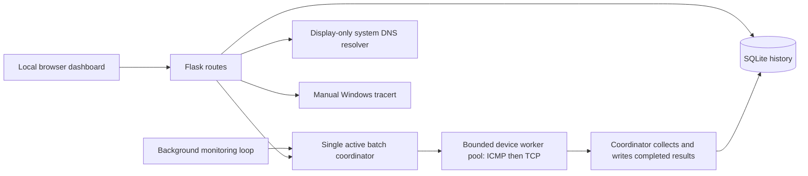

# NetScope

A student-built network monitoring and diagnostics project for a computer engineering portfolio. NetScope combines a local Flask dashboard, independent ICMP and TCP checks, and persistent SQLite measurements to help explain what a network check can—and cannot—tell you.

The dashboard uses real backend results. There are no simulated production measurements. This is a local, single-user learning tool for systems you own or have permission to test.

## Features

| Area | Implemented behavior |
| --- | --- |
| Device monitoring | Add named loopback/private IPv4 devices and a TCP service port; view independent checks in a compact, sortable dark-mode device table. |
| ICMP | Five Echo Requests per device per cycle; parse actual ping replies and completed batch statistics. |
| Packet loss | Sent, received, unanswered, and percentage lost within each completed five-probe cycle. |
| RTT | Reply-derived average/minimum/maximum RTT; preserve `<1 ms` bounds and show unavailable measurements as N/A. |
| TCP | Independent connection checks with distinct refusal, timeout, network-error, and unavailable diagnostics. |
| History | SQLite-backed latency and packet-loss charts, device selection and history navigation, empty/loading/error states. |
| Availability | Separate ICMP and TCP check availability summaries with valid/excluded sample counts, observation windows, and a success/failure/unknown timeline. |
| DNS | Manual, display-only system resolver lookup of public domain names; show available IPv4/IPv6 results, duration, and explanatory errors. |
| Traceroute | Manual Windows `tracert -d -4` to an explicitly authorized private/loopback destination; three measurements per hop and reached/incomplete/failure states. |
| Safeguards | Strict destination validation, bounded commands and inputs, local browser request boundary, diagnostic rate limits, and prevention of overlapping monitoring batches. |

## Screenshots

These are genuine captures from an isolated loopback-only preview using real SQLite records and ping/TCP results. Unavailable exact RTT remains N/A; the interface does not manufacture numerical samples. See [screenshots/README.md](screenshots/README.md) for provenance and the capture/privacy checklist.


## Technologies

- Python 3.10+; Flask for routes/templates and Werkzeug for HTTP errors.
- Python standard library: SQLite, sockets, subprocesses, IP validation, threading, and unit tests.
- HTML, CSS, and vanilla JavaScript with Canvas charts; no frontend framework or chart dependency.
- Windows system `ping.exe` and `tracert.exe`.
- Node.js built-in test runner for frontend regression tests; Node is optional for running the app.

`requirements.txt` lists Flask, Werkzeug and ReportLab (local PDF generation); pip installs their transitive dependencies, including Pillow/charset-normalizer for ReportLab. SQLite is included with Python; no database server or npm installation is required. `requirements-dev.txt` additionally installs pypdf for PDF parsing tests; the running application does not use it. Verified reporting versions: ReportLab 4.5.1 and pypdf 6.21.2.

## Architecture



`app.py` owns validation, measurement collection/persistence, availability classification, and routes. `monitoring_coordinator.py` owns the bounded executor, batch admission, completed-result collection, and shutdown. `dns_diagnostics.py` and `traceroute_diagnostics.py` isolate manual diagnostics. Neither diagnostic automatically runs during monitoring or writes lookup/trace results to the monitoring database.

A monitoring thread coordinates one batch at a time. Up to **4 devices** are checked concurrently by a `ThreadPoolExecutor` (configurable 1–16). Each device still runs five ICMP probes followed by its independent TCP check. Worker threads never use SQLite: the thread coordinating the batch writes completed measurements one at a time using short, separate transactions. The executor queues the current target snapshot; it does not queue additional monitoring batches.

The original process-local batch lock covers target snapshot loading, all futures, and persistence. Competing checks return busy rather than queueing another batch; device changes remain blocked until results have settled, preventing target deletion/ID reuse races. The configured interval is a delay **after** the batch finishes, so the actual sampling period includes probe and persistence time. The browser continues polling every 10 seconds.

`collect_measurement()` and `persist_measurement()` separate probes from writes. `run_check()` remains a compatible single-target collection/persistence wrapper. Completed negative network results keep their existing meanings. Unexpected protocol errors preserve the other protocol's measurement and become unknown/unavailable, excluded from the relevant availability denominator. Useful partial rows can be saved while the batch reports execution failure (HTTP 503). Whole-task failures, cancelled unstarted work, and failed database inserts do not create synthetic offline records. Persistence is attempted once per outcome; a failure is logged and counted without replaying an uncertain insert.

On normal server exit or Ctrl+C, the launcher signals stop, rejects new batches, cancels queued work, allows already-started bounded probes to finish, persists available results, and joins monitoring/executor threads. It does not hold lifecycle locks while waiting. Python cannot kill a running worker thread safely; shutdown can take the remaining probe deadlines plus SQLite waits. Forced process termination can lose in-flight work. A stopped coordinator is terminal; restart the application to resume.

SQLite stores targets and timestamped results, uses WAL mode and parameterized request values, and applies additive migrations for older databases. History responses and availability summaries cover the latest **60 stored rows per device**, with history returned chronologically. Older rows remain stored.

Schema version 5 is tracked with SQLite `PRAGMA user_version`. Startup upgrades fresh and compatible version-0 through version-4 databases, including partially applied historical measurement columns, in an explicit transaction. Version 2 adds persistent incident/configuration tables; version 3 records acknowledgement time and operator note; version 4 adds notification events, stream metadata, an unread index and transition triggers; version 5 adds a separate discovery observation table and address/history index without rebuilding existing tables. Existing rows are preserved; only a fresh database receives the default target. Schema changes, configuration, the version update, and seeding commit together or roll back together. Unknown versions, incompatible schemas, and foreign-key violations stop initialization rather than resetting data. WAL configuration occurs before the migration transaction and is not rolled back. Downgrades and automatic repair are not supported.

New measurements are validated before insertion: flags must be 0/1, timestamps timezone-aware, RTT values finite and nonnegative, and completed packet counts/loss internally consistent. Unknown measurements may retain null statistics. This application safeguard does not rewrite legacy history or add table constraints; direct SQLite writes can bypass it. Startup also verifies foreign-key enforcement and the history index definition.

```text
netscope_starter/
├── app.py
├── monitoring_coordinator.py
├── dns_diagnostics.py
├── traceroute_diagnostics.py
├── requirements.txt
├── templates/index.html
├── static/
│   ├── app.js
│   └── style.css
├── tests/                    # Python and JavaScript regression tests
├── screenshots/              # Capture instructions and empty category folders
├── AUDIT.md                  # Preserved technical audit
├── README.md
└── .gitignore
```

The runtime database and virtual environment are deliberately absent from the publication tree.

## Windows setup

Prerequisites: Windows, Python 3.10 or later with the Python launcher, and a browser. Windows provides the ping and traceroute commands. Git is useful for cloning but is not an application dependency.

In PowerShell, open the project directory and run:

```powershell
py --version
py -m venv .venv
.\.venv\Scripts\python.exe -m pip install -r requirements.txt
.\.venv\Scripts\python.exe app.py
```

These commands use the virtual environment directly; activation and changes to PowerShell execution policy are unnecessary. Paste `http://127.0.0.1:5000` into the browser address bar. Press Ctrl+C in the terminal to stop the application.

The supplied entry point binds only to `127.0.0.1:5000`, with debug mode and the reloader disabled. Use this entry point so database initialization and the background thread run. Do not expose it through a public binding, tunnel, proxy, or multiple worker processes.

A new database seeds **Local computer**, `127.0.0.1`, TCP port 80. A closed port 80 is a legitimate TCP refusal even when localhost answers ping. Existing databases retain their device list and history; intentionally empty device lists stay empty on restart.

### Configuration

Set environment variables before starting the application:

| Variable | Default | Meaning / supported range |
| --- | --- | --- |
| `NETSCOPE_DB` | `netscope.db` beside `app.py` | Local SQLite path; keep the database and sidecar files private. |
| `NETSCOPE_CHECK_INTERVAL` | `30` | Seconds between completed batches; 1–3600. |
| `NETSCOPE_ICMP_TIMEOUT_MS` | `1000` | Per-probe ICMP wait in milliseconds; 100–10000. |
| `NETSCOPE_TCP_TIMEOUT` | `1.5` | TCP connection timeout in seconds; 0.1–30. |
| `NETSCOPE_MONITOR_WORKERS` | `4` | Integer device-worker limit; 1–16. Use 1 for sequential fallback. |
| `NETSCOPE_DISCOVERY_TIMEOUT_MS` | `500` | Discovery echo wait, 100–1000 ms; separate from monitoring. Invalid settings stop startup. |

For example:

```powershell
$env:NETSCOPE_CHECK_INTERVAL = '30'
$env:NETSCOPE_ICMP_TIMEOUT_MS = '1000'
$env:NETSCOPE_TCP_TIMEOUT = '1.5'
$env:NETSCOPE_MONITOR_WORKERS = '4'
.\.venv\Scripts\python.exe app.py
```

There are always five ICMP requests per monitoring cycle. The ping subprocess also has an overall deadline. Invalid timeout/interval/worker configuration stops startup rather than silently using unsafe values.

## Usage

### Local application logs

The supplied `python app.py` launcher writes JSON lines to the console and `logs/netscope.log` beside the application. Application and Werkzeug server records use the same privacy-conscious formatter. Each record includes UTC time, severity and an event type; monitoring batches also include a random batch identifier, elapsed milliseconds and result counts where applicable. Unexpected probe and database failures are errors; completed batches with execution failures are warnings. Expected network refusals/timeouts remain measurement results and do not generate per-device application errors.

| Variable | Default | Meaning |
| --- | --- | --- |
| `NETSCOPE_LOG_LEVEL` | `INFO` | `DEBUG`, `INFO`, `WARNING`, `ERROR`, or `CRITICAL`. |
| `NETSCOPE_LOG_DIR` | `logs` beside `app.py` | Local output directory; keep it private. |
| `NETSCOPE_LOG_MAX_BYTES` | `1048576` | Rotation threshold in bytes; 1024–104857600. |
| `NETSCOPE_LOG_BACKUPS` | `3` | Retained rotated files; 1–20. |

Rotation retains the active file plus the configured number of numbered backups. Invalid configuration or an unwritable log directory stops startup. Logging is configured by the launcher, not by importing application modules. The formatter omits raw messages, request URLs/bodies, target names/addresses, database paths/rows, exception messages and traceback text; exceptions retain their class name. This deliberately limits debugging detail. Use event types, batch identifiers and failure phases to correlate events. Generic server/framework messages appear as `application_message`. Raising the minimum log level suppresses lower-severity lifecycle events. Default `logs/` is Git-ignored; custom output locations must be kept out of publication.

### Dashboard workflow

1. Start with the preloaded localhost device. Wait for the first monitoring cycle, or request a manual check.
2. Add another device only if you own it or have explicit permission. Enter a descriptive name, a literal RFC1918/loopback IPv4 address, and the specific TCP port you want to check. Do not assume a router has an open web port.
3. Read the ICMP and TCP rows independently. A filtered ping or refused TCP connection does not establish that the whole device is offline.
4. Select a device name or click **View history** in its table row. The dashboard selects that device, displays its name/IP, loads stored measurements, and moves to its history charts. A new device can legitimately have no history yet. Click a column heading to sort ascending/descending. IP addresses, exact RTT, packet loss, and timestamps sort numerically; unavailable/bounded RTT values stay after exact samples. On smaller screens, the inventory scrolls horizontally while detail panels stack vertically.
5. In Diagnostics, enter a public domain such as `example.com` for a manual system DNS lookup. Results depend on your actual resolver; no particular address or address family is guaranteed.
6. For traceroute, enter an authorized private/loopback IPv4 destination, choose a hop limit, and confirm permission for that destination. Selecting a device prefills its address when no trace is active and clears prior permission; this never starts a trace automatically. A `*` means a probe received no reply within its wait, not proof of an intermediate router outage.

Adding/removing devices or requesting another batch while monitoring is active can return a busy message (HTTP 409). **Run checks** submits an asynchronous job and polls its status about once per second, refreshing device/history data as tasks settle. The button stays disabled while that job is tracked; its status is announced through a keyboard-accessible live region. Transient status-request failures retry without submitting another batch. Terminal states stop job polling; ordinary dashboard polling continues every 10 seconds. Submission/status requests have a 10-second browser wait, independent of the batch duration. A lost submission response may leave a running job; it is never automatically resubmitted. Disconnecting does not cancel server work or release the batch lock.

The legacy `/api/check` endpoint and Python `check_all()` remain synchronous for compatibility and retain their existing response fields/status codes. Their old HTTP wait limitations still apply. Removing a device also deletes its associated history through the existing database relationship; keep a private backup if you need those records.

### Historical time ranges and comparison

Use **History range** for the last 1 hour, 6 hours, 24 hours, 7 days or 30 days. The default Latest 60 records keeps the original inspector/history API behavior. Select two to four devices in **Compare devices** to overlay exact RTT and packet loss on common time/measurement axes, with separate ICMP/TCP sampled-check dots. Device colors match numbered textual summaries; ICMP uses circles and TCP squares. Comparison defaults to 24 hours when Latest 60 is selected. Regular dashboard polling and manual-job updates refresh active histories and comparisons without reloading the page.

Chart and timeline positions represent actual elapsed time. Lines break at missing/unknown values and collection gaps over five minutes; this is a display threshold, not an outage detector. Bounds such as `<1 ms` never become numerical RTT points. Availability dots represent individual successful/failed observations; missing dots and unknown checks do not establish downtime or continuous uptime. Timestamp labels include the date in the browser's local timezone; API windows are UTC. Duplicate timestamps can overlap visually. Slow sampling intervals over five minutes intentionally display isolated dots.

Per-device range summaries cover **all matching records**, even when the plotted records are capped. They include record/valid/unknown counts; exact per-cycle RTT sample count, mean/min/max and missing RTT count; mean packet loss with valid/missing counts; and separate ICMP/TCP sampled availability denominators and exclusions. A record is valid if at least one protocol is classifiable. Missing RTT includes failed, bounded, legacy and invalid readings. The existing device-list/inspector availability cards still explicitly cover their latest 60 stored rows.

`GET /api/history?targets=1,2&range=6h` returns `{start, end, point_limit, series}`. Each series contains `{target_id, name, points, summary, truncated, returned_points}`. At most four distinct positive device IDs and one supported range are accepted; malformed/duplicate parameters return 400 and nonexistent devices return 404. All devices share one read snapshot and exact start/end window. SQL values are parameterized and records are ordered by SQLite `julianday(checked_at)` with ID as a tie-breaker, so insertion order and timezone offsets do not distort ordering.

`GET /api/targets/1/history?range=6h` also supports a bounded, timestamp-ordered array for compatibility with array clients. Without parameters it still returns the latest 60 inserted rows exactly as before. Use `/api/history` for full-window summaries and explicit truncation metadata. The dashboard uses that summary endpoint when a time range is selected.

Payloads include only the **newest 2,000 rows per device**, without interpolation or invented bucket averages. A visible truncation notice identifies this chart subset; older parts of the selected window may therefore be blank even while their observations contribute to summaries. Malformed timestamps cannot be assigned to a time window and are excluded; timezone-naive rows that SQLite can place in the window are counted as invalid timestamps and have unknown protocol states. Custom start/end dates are deferred.

Startup adds the optional `idx_results_observed` expression index on device ID, guarded Julian timestamp, and record ID after schema validation; measurement tables and existing rows remain unchanged (the incident foundation and acknowledgement use schema version 3). Only timestamps starting with a four-digit year and hyphen are converted, so SQLite aliases such as legacy text `now` remain stored without causing non-deterministic-index errors. This requires SQLite expression-index support (SQLite 3.9+, included in the supported Python environment). The first initialization builds the index over existing history and needs disk space/time proportional to history size. Summaries stream matching rows with bounded memory; work scales with the selected window's record count. A ten-second analysis budget returns a safe 503 for unusually large/slow queries; choose fewer devices or a shorter range. Long WAL read snapshots can delay checkpoint reclamation during analysis. No retention, deletion, or automatic database reset is introduced.

### Automatic incidents and incident dashboard

Successfully committed measurements feed four independent conditions:

| Condition | Qualifying bad observation | Default opening/recovery |
| --- | --- | --- |
| `icmp_unavailable` | A complete, classifiable ICMP cycle with no successful Echo Replies | 3 bad / 2 successful cycles |
| `tcp_unavailable` | A classifiable refusal, timeout or known network error | 3 bad / 2 successful connections |
| `packet_loss` | Valid completed-cycle loss strictly above 40% | 3 above / 2 at or below threshold |
| `high_latency` | Valid exact cycle-mean RTT strictly above 200 ms | 3 above / 2 at or below threshold |

ICMP and TCP remain independent: ICMP recovery cannot resolve a TCP incident. Valid 100% packet loss can qualify for both ICMP and packet-loss incidents. Bounded RTT such as `<1 ms`, malformed/incomplete cycles and unexpected execution errors are unknown for the affected condition; they never open or resolve it and break pending failure/recovery streaks. The other protocol can still qualify independently. A gap longer than five minutes also resets pending streaks on the next observation; elapsed time alone never resolves an incident. No incident claims continuous downtime or application-level service health.

| Environment variable | Default | Accepted values |
| --- | --- | --- |
| `NETSCOPE_INCIDENT_OPEN_CHECKS` | `3` | Integer 1–100, applied to all conditions |
| `NETSCOPE_INCIDENT_RECOVERY_CHECKS` | `2` | Integer 1–100, applied to all conditions |
| `NETSCOPE_INCIDENT_MAX_GAP_SECONDS` | `300` | Integer 30–86400 |
| `NETSCOPE_INCIDENT_LOSS_PCT` | `40` | Finite number 0–100 |
| `NETSCOPE_INCIDENT_LATENCY_MS` | `200` | Finite number 0–60000 |

Configuration lives in `alert_config`. Explicit environment values update it at startup; absent variables retain persisted settings. Invalid settings stop startup. Changes increment a configuration revision and reset that condition's pending streaks at its next new observation, without deleting or rewriting existing incidents. Future qualification/recovery uses the new settings; each incident preserves its original triggering thresholds, and resolution stores the thresholds actually used for recovery. No configuration write API is provided.

Version 2 adds `incidents`, `alert_config`, `incident_cursors` and `incident_streaks`, plus indexes. Incidents store IDs, condition/state, first/latest observation timestamps, nullable resolution timestamp/duration, relevant measurement IDs and compact numeric evidence/configuration snapshots. A partial unique index prevents multiple active incidents for the same target/condition. Lifecycle transitions support **OPEN → ACKNOWLEDGED → RESOLVED**, or direct **OPEN → RESOLVED** on verified recovery. Acknowledged incidents remain active for deduplication and recovery; acknowledgement does not reset streaks, suppress monitoring or fabricate resolution. Resolved duration is the sampled span from the first qualifying failure to confirmed recovery, including gaps; it is not a precise outage duration.

Measurement persistence commits first. A separate `BEGIN IMMEDIATE` transaction reads committed rows, evaluates state and advances a durable per-target cursor atomically. Evaluation errors roll back incident work, emit `incident_evaluation_failure`, and leave already-committed measurements and monitoring result counts intact. Pending work is retried after the next successful write for that target or on restart. Transition events `incident_opened` and `incident_resolved` are logged only after commit and contain only incident ID/condition metadata.

Pending records are ordered by observation time and ID, independently per device. Only the first accepted observation at a unique timestamp can advance streaks. Later duplicates and observations at/before that device's watermark are consumed without changing incidents; stale data does not rewrite established history. This conservative policy avoids backdated transitions but does not reconstruct an ideal incident timeline from arbitrarily late imports. Invalid timestamps break pending streaks. Failed database writes contribute no observations; undetected gaps between persisted samples cannot prove consecutive real-world failures.

On upgrade, cursors start after existing measurements: incidents are detected prospectively, with no automatic historical backfill. Restarts retain streaks, active incidents and pending cursors. Device deletion still removes its monitoring history, but preserves incident evidence with `target_id=null` and `original_target_id` retained. Deleted targets' incidents stay in their last state; deletion does not fabricate recovery. A newly created device reusing an ID cannot inherit those incidents or counters. Numeric evidence snapshots remain available even after the underlying result rows are deleted.

Read-only API:

- `GET /api/incidents`: `{start, end, incidents, next_before_id}` ordered by descending incident ID. Optional filters: `target_id`, `condition`, `state` (`OPEN`, `ACKNOWLEDGED`, `RESOLVED`, or `ACTIVE` for open plus acknowledged), and `range` (`1h`, `6h`, `24h`, `7d`, `30d`; default `30d`). Alternatively supply timezone-aware `start` and `end` for a positive window of at most 30 days, without `range`. The list includes observed incident lifecycles overlapping that window, including still-open older incidents.
- `limit` defaults to 100, maximum 200. Pass returned `next_before_id` as `before_id` to page backwards. Unsupported/repeated or invalid filters return 400. A deleted device's detached incidents remain in the unfiltered list; a `target_id` filter applies to current target links.
- `GET /api/incidents/<id>` returns one incident with parsed evidence/configuration objects, or 404. Responses omit target names, IP addresses, full measurement records and raw exceptions. Existing loopback/origin checks, JSON database failures and `no-store` headers apply. The acknowledgement endpoint below is the only incident mutation API.

Incident evaluation adds serialized local SQLite transactions after measurement commits. A prolonged evaluation failure can accumulate a retry backlog and delay processing on restart; stored measurements remain the source of truth. There is no incident retention policy. External notification providers remain unimplemented; local downloadable reports are described below.

### Incident acknowledgement and UI

Use **Incidents** in the sidebar to reach the dashboard section above the device inventory. The header shows actual all-stored OPEN/ACKNOWLEDGED counts by condition, including preserved incidents for removed devices; these global counts are independent of the timeline filters. The default timeline shows active incidents over the 30-day overlap window. Filter by current device, condition, state or supported time range. Rows show device/condition, first observation, the threshold-confirming opening time, current state, elapsed/sample-span duration, recovery time and trigger values/thresholds. Removed devices are identified by their retained original ID.

The UI fetches the newest 100 matching records using the existing list API and displays that bounded set chronologically by first observation (newest first). A truncation notice asks users to narrow filters for older records; API clients can still paginate with `before_id`. **Details** shows persisted evidence/result IDs, acknowledgement information and verified recovery. Native selects/buttons, a focusable detail panel and live status messages support keyboard use; filters stack on small screens. Acknowledged, open and resolved states have distinct text labels and border colors. Updates reuse normal dashboard polling and monitoring-job refreshes, with no separate WebSocket service. Transient failures retain visible data with a stale warning. Operator note drafts remain intact during polling; focused note fields are not replaced by background refreshes.

- `GET /api/incidents/summary` returns `{active, open, acknowledged, by_condition}` aggregated from stored active incidents across all dates/devices. `by_condition` contains OPEN and ACKNOWLEDGED counts for each condition. Existing read endpoints retain their response shape and ID-based pagination; detail/list objects now also include nullable `acknowledged_at` and `operator_note` fields.
- `POST /api/incidents/<id>/acknowledge` accepts a JSON object `{}` or `{"note":"Investigating locally"}`. Notes are optional plain text, at most 500 characters; whitespace-only notes become null and unsafe control characters are rejected. The response is the incident detail object with HTTP 200. All existing loopback peer/Host, same-origin, body-size, JSON error and no-store safeguards apply. There is no login or implied operator identity; a trusted local process can also acknowledge.
- The first successful acknowledgement atomically stores UTC `acknowledged_at`, the optional note and state ACKNOWLEDGED in a short write transaction. Repeat/concurrent requests preserve the original time/note and return the existing record. If an already-acknowledged incident has since recovered, a repeat request returns its RESOLVED record without changing it. Newly acknowledging an unacknowledged RESOLVED incident returns 409. Unknown IDs return 404; invalid bodies/notes return 400, non-JSON content 415, oversized bodies 413 and database failures 503.
- The UI offers **Acknowledge** only for OPEN incidents, disables duplicate in-flight actions and refreshes state after success. Notes are rendered as text, not HTML, and are omitted from logs. `incident_acknowledged` logs only the incident ID/condition after commit. Notes cannot be edited later through this API; avoid entering credentials or sensitive information because the note remains in the local database and incident detail responses.

Migration version 3 adds nullable `acknowledged_at` and a length-constrained `operator_note` column. Existing incident IDs, states, evidence, configuration and evaluation cursors are preserved. Migration changes and `user_version` roll back together on failure. Acknowledgement does not resolve detached/deleted-device incidents: without future measurements those records cannot automatically recover. There are no manual resolution, unacknowledge or note-edit actions. This remains a single-user local tool, not an authenticated audit trail.

### Incident notifications

The header's **Notifications** control shows the persisted unread count. Its panel distinguishes opened and resolved events, shows observation and recording times, links to incident details, and offers individual or snapshot-based **Mark all read** controls. Reading a notification does not acknowledge or resolve its incident. Read state is shared by local clients and survives restarts; the open panel refreshes read markers from other clients. Existing dashboard polling fetches new events every ten seconds, including transitions that both occur between polls. The panel keeps at most 200 recent events in memory and offers older pages within that bound. Failed requests retain displayed data and show an error.

Version 4 adds `notification_events` and `notification_meta`. SQLite triggers write `incident_opened` and `incident_resolved` events in the same transaction as the incident transition and evaluation cursor. Events become visible only after commit; an event-write failure rolls back incident evaluation and is logged through the existing evaluation-failure path for retry. Measurement persistence remains independent. A unique `(incident_id,event_type)` constraint prevents duplicates across retries/restarts. Acknowledgement remains an informational structured log event and does not generate an alert. Events retain incident associations after device deletion, with no names, addresses or operator notes copied into notifications. Migration does not backfill old transitions; a previously open incident can still produce a future recovery event. Notification storage has no automatic retention policy.

- `GET /api/notifications?limit=50` returns `{events, unread_count, latest_id, stream_id, next_after_id, next_before_id, has_more}`. Events contain `id`, `incident_id`, `event_type`, `event_at`, `created_at`, nullable `read_at`, `condition`, nullable `target_id`, and `original_target_id`. Responses are ordered by recording ID ascending, independently of observation timestamps. The initial request returns the latest page; `before_id` pages backwards and `after_id` retrieves new events. Use returned `next_after_id` until `has_more` is false. `limit` is 1–200, default 50; cursors are bounded integers and cannot be combined. Unread count covers all stored events, independently of the page. A persistent stream ID distinguishes a replaced database from the previous event stream.
- `POST /api/notifications/<id>/read` accepts JSON `{}` and returns `{id, read_at, unread_count}`; unknown IDs return 404. Repeated reads preserve the original read timestamp.
- `POST /api/notifications/read` accepts `{"up_to_id":123}` and marks unread events through that observed ID, leaving later arrivals unread. It returns `{up_to_id, read_at, unread_count}`. Both mutations are idempotent and enforce the existing local peer/Host/origin, JSON/body-size and no-store protections. Invalid inputs return 400/415 and database errors return safe 503 responses.

Desktop alerts are **disabled by default** and independent of in-app notifications. Use the panel's desktop preference button to enable them; permission is requested only from that gesture. Denied permission, insecure/unsupported browsers, restricted storage and delivery errors leave in-app notifications available. The browser/OS can suppress alerts; mobile browsers may not support the constructor used here. See [MDN's browser notification guidance](https://developer.mozilla.org/en-US/docs/Web/API/Notifications_API/Using_the_Notifications_API).

Enabling desktop alerts establishes the current event baseline rather than replaying old unread events. A per-stream localStorage cursor and stable notification tags suppress repeats during polling, reconnects and reloads. At most five desktop alerts are attempted per fetched batch; the remainder remain in-app. Delivery is best effort: simultaneous tabs can race, clearing storage loses preferences, and consuming an event before OS delivery can lose a desktop alert if delivery fails. Without storage, deduplication is limited to the current page. Desktop notifications require the dashboard page to remain open; there is no service worker or closed-browser delivery. Permission and OS display were tested with deterministic mocks, not verified across browser/OS combinations.

### Reading individual measurements

**Packet loss** describes one completed ICMP cycle:

```text
packet loss = unanswered Echo Requests / 5 × 100
```

For example, three successful Echo Replies out of five requests means 40% packet loss. Windows destination-unreachable messages are not counted as successful Echo Replies. A malformed/incomplete batch produces unavailable loss statistics, not invented 100% loss.

**RTT** is the time reported by an Echo Reply, not the time spent launching the ping process. Missing replies never contribute zero milliseconds. Exact cycle RTT statistics require usable exact RTTs for all successful replies. If replies include a bound such as `<1 ms`, the app preserves a bound instead of inventing an exact mean; these cycles are not plotted as exact numerical latency. A completed cycle with no successful replies has no RTT.

**Check availability** compares completed, classifiable checks across the displayed history window:

```text
ICMP check availability = successful ICMP cycles / valid completed ICMP cycles × 100
TCP check availability  = successful TCP connections / valid completed TCP checks × 100
```

An ICMP cycle succeeds when at least one Echo Reply is received. Thus, a cycle can have partial packet loss and still be a successful ICMP check. Each protocol has its own denominator; unknown, incomplete, unclassifiable, and legacy results are excluded as appropriate. Every percentage includes sample counts and its qualifying observation window. No valid samples means N/A. These metrics are polling observations, not continuous uptime or exact outage durations.

### Local API reference

Requests must originate through the local dashboard boundary. JSON mutations can also be made from local tools with the correct Host and no foreign Origin.

| Method | Endpoint | Purpose |
| --- | --- | --- |
| GET | `/api/targets` | Devices, latest results, and availability summaries. |
| POST | `/api/targets` | Add `{ "name": "Local test", "ip": "127.0.0.1", "port": 80 }`. |
| DELETE | `/api/targets/<id>` | Remove a device and its history. |
| GET | `/api/targets/<id>/history` | Up to 60 stored measurements, oldest to newest within that window. |
| POST | `/api/check` | Legacy synchronous batch; report completed/failed counts. |
| POST | `/api/check-jobs` | Reserve the existing coordinator and return HTTP 202 plus job status and a `Location` header. No request body required. |
| GET | `/api/check-jobs/<job_id>` | Read a retained job snapshot; HTTP 404 if unknown, evicted or lost on restart. |
| POST | `/api/dns` | Lookup `{ "domain": "example.com" }`. |
| POST | `/api/traceroute` | Trace `{ "ip": "127.0.0.1", "authorized": true, "max_hops": 12 }`. |

Read-only example in PowerShell:

```powershell
Invoke-RestMethod -Uri 'http://127.0.0.1:5000/api/targets'
```

### Manual monitoring job lifecycle

An accepted submission returns HTTP 202, for example:

```json
{"job_id":"f73a1f3b36aa4d09a1fb518a882ccf11","state":"queued","total":0,"completed":0,"failed":0,"progress_percentage":0,"started_at":null,"ended_at":null,"error":null}
```

The background runner may already have changed the returned state to running or terminal before the HTTP response arrives. Poll the `Location` header, such as `/api/check-jobs/f73a1f3b36aa4d09a1fb518a882ccf11`. A settled snapshot can look like:

```json
{"job_id":"f73a1f3b36aa4d09a1fb518a882ccf11","state":"failed","total":4,"completed":3,"failed":1,"progress_percentage":100.0,"started_at":"2026-10-22T12:00:00.000+00:00","ended_at":"2026-10-22T12:00:05.000+00:00","error":"Some checks failed to execute or persist. See local logs."}
```

These examples illustrate the API contract, not monitoring data. Jobs move from queued to running, then completed, failed or cancelled. Totals become known after the target snapshot loads. Completed counts successful collection/persistence tasks, including legitimate negative network results. Failed counts execution/persistence failures and cancelled or unsubmitted tasks explicitly settled by the coordinator. Useful partial protocol results may still have been persisted for a failed task. Progress is `(completed + failed) / total × 100`, updated only after persistence returns or a task is explicitly failed/cancelled; it does not count submitted futures. An empty successful batch completes at 100%. Snapshot/startup failures can finish with unknown totals and 0% progress. Timestamps are UTC and nullable before the relevant lifecycle step.

Jobs use one background coordinating thread and the existing bounded probe executor, batch lock and single-writer persistence. Automatic monitoring, legacy calls and new jobs share admission: competing submissions return 409 immediately and are never queued behind a running batch. Device mutations remain blocked until results settle. On shutdown, queued probes are cancelled, started probes finish within their existing deadlines, available results are persisted, and the job becomes terminal before coordinator shutdown returns. There is no individual cancel endpoint.

Only the latest **64 accepted jobs** are retained in process memory; older terminal records are evicted when another job is accepted. Status access does not extend retention. Job state is not stored in SQLite, is not durable across restarts, and cannot be shared between server processes. The browser tracks its current job only while the page remains open. Forced process termination can lose in-flight work and status; a subsequent status request returns 404. Local request security restrictions apply to both new routes.

Validation/access errors use HTTP 400/403, unsupported content uses 415, oversized bodies use 413, busy/rate-limited diagnostics use 429, and database/batch execution failures can use 503. Traceroute is Windows-only (501 elsewhere). A completed diagnostic may return HTTP 200 with an unsuccessful result and an explanatory code/status; inspect the response fields, not only HTTP status.

### Authorized IPv4 discovery

Use **Network Discovery** to enter an exact CIDR and explicitly confirm permission for that specific scan. Changing the CIDR clears consent; each submission consumes the checkbox. The backend independently requires JSON `authorized: true`, strict canonical IPv4 CIDR notation, RFC1918 or loopback scope, and at most **32 usable hosts**. It rejects public, link-local, multicast, carrier-grade NAT, IPv6, unrestricted ranges and CIDRs containing host bits. It never normalizes a larger network silently. For ordinary subnets network/broadcast addresses are excluded; `/31` includes both addresses and `/32` includes its sole address. Thus `/27` has 30 usable hosts and `/26` is rejected. A safe input example is `127.0.0.1/32`; no example is run automatically. Authorization is a user assertion, not proof of ownership.

Discovery sends **one ICMP echo per selected address**, with a separate fixed two-worker executor and bounded subprocess deadline (configured wait plus one second). It does not probe TCP ports, resolve hostnames, collect banners or credentials, fingerprint devices, infer manufacturers/services, or scan via ARP. Results are `responding` (parsed echo reply), `unresponsive` (completed command without a verified echo reply), or `unknown` (execution/unavailable-command/deadline problem). No reply does not establish that a device is absent or down: ICMP filtering, routing and rate limits can hide devices. This is observed reachability, not complete enumeration.

Only an explicit Start Scan POST starts work. Startup, dashboard reads and automatic monitoring never start discovery. One discovery job is admitted at a time; at most two accepted scans per rolling minute per process. Discovery reserves the existing monitoring admission and traceroute slot, rejecting scans while either is active. While discovery runs, manual checks/device mutations are busy and automatic cycles skip that admission attempt, preserving existing scheduling behavior. DNS remains independently bounded by its existing resolver limit. Discovery uses no monitoring pool workers. Slow SQLite writes can extend the reservation beyond probe time.

The panel polls progress every second while its job is active and refreshes inventory with normal dashboard polling. Completed counts only committed observations or explicitly failed tasks, never submitted futures; failed is a subset counting unknown/execution/persistence outcomes. Cancelled tasks that never ran produce no invented observations. Cancellation is cooperative: up to two already-started probes can finish and persist. Normal shutdown cancels queued work, drains started probes and joins the discovery thread. A forced exit can lose in-flight work. Jobs are process-local, capped at the latest 32, lost on restart and not automatically resumed; observations already committed survive. Closing the page does not cancel a server job. A timed-out submission is never automatically retried.

Schema v5 adds `discovery_observations`: immutable observation ID, random scan ID, explicitly authorized CIDR, address, method `icmp_echo`, UTC observation time and classification, with unique `(scan_id,address)` and an address/descending-ID index. Each result and retention pruning commit atomically. At most **2,048 discovery observations globally** are retained, oldest IDs pruned on new writes. This preserves bounded observation history independently of targets, monitoring results, incidents and notifications. No legacy data is backfilled. Local network addresses/scopes are private runtime data stored only in the ignored SQLite database; discovery logs omit destinations and raw exception text using the existing formatter.

Inventory shows the latest observation per address, including unresponsive/unknown outcomes, with up to 200 addresses displayed. It can be stale and contains no unverified metadata. **Configure monitoring** is offered only for responding observations and opens a deliberate name/TCP-port form. Enrollment revalidates the stored IP and port, serializes with target mutations and a SQLite write transaction, and rejects an already-monitored IP with 409 and its existing target ID rather than adding another port/duplicate unexpectedly. Nothing is enrolled automatically; enrollment enables future normal scheduled ICMP/TCP checks. An observation can expire through retention before enrollment (404). Deleting a monitored device leaves discovery observations subject to their own retention.

Discovery API (all existing loopback peer/Host, Origin/fetch-site, body-size, JSON and no-store protections apply):

| Method | Endpoint | Contract |
| --- | --- | --- |
| POST | `/api/discovery/jobs` | Exact JSON `{"cidr":"127.0.0.1/32","authorized":true}`; 202 with job snapshot and `Location`. Invalid scope/consent 400, active monitoring/traceroute/discovery 409, quota 429, stopping/start failure 503. |
| GET | `/api/discovery/jobs/<job_id>` | Snapshot: `job_id`, `cidr`, `state`, `total`, `completed`, `failed`, `progress_percentage`, `started_at`, `ended_at`, nullable safe `error`. States queued/running/completed/failed/cancelled. Missing/expired/restarted job 404. |
| POST | `/api/discovery/jobs/<job_id>/cancel` | JSON `{}`; idempotently request cancellation and return snapshot. Terminal jobs keep their state; unknown ID 404. |
| GET | `/api/discovery/inventory` | Latest observation per address, descending recording ID. |
| GET | `/api/discovery/observations` | Retained observation history, descending recording ID. |
| POST | `/api/discovery/observations/<id>/enroll` | Exact JSON `{"name":"My authorized device","port":443}`; 201 `{"id":target_id}`. Unknown/expired observation 404; nonresponding/already-monitored address 409; invalid name/port 400. |

Both list APIs return `{observations, next_before_id}` and accept `limit` (default 50, 1–200) and optional positive `before_id`; repeat/unknown/invalid filters are rejected. ID ordering reflects recording order, not inferred topology or observation order across workers. Inventory pagination can change while new scans finish. Mutation JSON errors use 400/415, oversized bodies 413 and database failures safe 503 responses. There is no scan scheduler, topology visualization, durable job queue or discovery authentication beyond the existing local boundary.

Discovery command construction and workflows are tested on Windows with **mocked network operations only**; no real discovery scan was run during implementation. Linux/macOS use a numeric single-echo command under the same overall deadline but have no runtime verification. A deadline can classify a nonreply as unknown. Localized/unfamiliar output may not yield a verified reply. Review and manually authorize a small scan separately before relying on platform behavior.

### Network Map: stored observations, not verified topology

Use **Network Map** to browse an unconnected SVG device map. It combines the existing `/api/targets` response with the latest bounded `/api/discovery/inventory?limit=200` page; no new data API, database migration or probe engine was added. Schema remains version 5. Opening, filtering, selecting or refreshing the map performs only reads and never starts discovery, ping, TCP checks or traceroute. Existing independent scheduled monitoring continues normally.

Each node represents one validated private/loopback IPv4 address. Matching discovery and monitored records merge by address; multiple monitored targets/ports at the same address appear together in details. User-assigned names are shown as labels, with full address/name/time in hover and accessible labels. Names, protocol diagnostics and metadata are rendered as text. Devices without assigned names remain unnamed; no hostname, device type, manufacturer, service or router identity is inferred.

Dashed /24 address buckets are **display groupings derived from the first three octets**, not measured subnet boundaries. Node positions are a deterministic grid, not geographical or physical positions. There are **no device-to-device edges**: subnet similarity, authorized scan scope and traceroute hops do not establish physical or logical links. The current database contains no verified link evidence. No star topology or inferred router is drawn.

Node ICMP color/text uses the newest supplied observation across monitoring and discovery; monitoring wins equal timestamps. A newer unknown outcome is not replaced with an older success. Monitored protocol states use the backend's existing independent classifications; completed negative network outcomes remain distinct from software/unclassified failures. Discovery contributes echo reply, no verified echo reply or unknown only. Missing/invalid timestamps and timestamps more than a minute ahead of this browser clock remain unknown. No reply never establishes device absence.

Green indicates a confirmed echo reply; muted red indicates a completed check with no echo reply; gray/dotted indicates unknown/not checked; amber/dashed indicates stale. Discovery observations exceed their display freshness window after five minutes. Monitoring reuses each target's existing `stale_after_seconds` (90 seconds fallback). Failed API refreshes also mark that source's stored outcomes stale. Details retain the stored result/time beside the stale label rather than presenting it as current. TCP status comes only from separately classified monitored checks, including refusal/timeout versus unknown execution outcomes, and has its own freshness classification; discovery never implies an open port. These are sampled measurements, not continuous uptime.

Select a node by click or Tab plus Enter/Space for discovery method, scope/time, latest monitoring outcomes/diagnostics, RTT/loss, separate ICMP/TCP sampled availability, inspector controls and active incidents. Active incidents are read from the existing ACTIVE/30-day overlap API only when a monitored node is selected and on subsequent dashboard refreshes. This includes still-active incidents opened before the window. The newest 200 active incidents are fetched globally; details explicitly warn when this page is incomplete and never claim its matching count is the complete total. Read failures retain an explicit stale/unavailable message. Incident buttons open the existing incident detail; no incident behavior changes.

Drag background space to pan, use the wheel or zoom buttons (50–300%), and use **Reset view** to return to the origin at 100%. With the map viewport focused, arrow keys pan, +/- zoom, and 0/Home reset. Nodes have hover labels, visible focus and keyboard activation. Status/enrollment filters do not discard a selected detail. Layout adapts column count to viewport width, avoids overlapping nodes and stacks details beneath the map on smaller screens. Large groups extend below the viewport and can be panned into view. Automatic updates reuse the ten-second dashboard polling and discovery inventory updates, preserving pan/zoom and selection. The explicit refresh control fetches stored data through that same workflow.

The map displays at most 200 merged addresses with monitored addresses prioritized, and reports any display cap. Discovery contributes only its existing newest 200-address inventory page; older retained addresses remain accessible through the discovery APIs. Selection can disappear after target deletion or inventory retention/page changes. Refreshes across APIs are separate snapshots, so changes can briefly disagree. Layout preferences are page-local and reset on reload; no cosmetic database state or dependencies were introduced. The frontend tests simulate DOM/SVG and input events; they do not replace browser/touch/assistive-technology verification. No real network scan was performed to validate this map.

### Advanced historical and incident analytics

The compact **Analytics** view reuses the existing History range selector (1h/6h/24h/7d/30d) and comparison-device checkboxes, falling back to the selected inspector device. Latest 60 uses a 24-hour analytics window. Choose **All incidents** for global incident statistics, including preserved deleted-device records. With no devices selected, the view also falls back to global incidents. Tables show exact RTT summaries/distributions, packet loss, separate sampled ICMP/TCP availability, preceding-window trends and incident statistics. Dashboard polling, device/range changes and Refresh analytics update these read-only summaries. Errors clear metric displays with a scoped explanation; stale request responses cannot replace newer selections. No reports, new probes or discovery are triggered.

Read-only endpoints, under the existing loopback/Host/origin/no-store protections:

- `GET /api/analytics?targets=1,2&range=24h`: one to four distinct current target IDs; unknown targets return 404. Returns `series` with per-device `current`, `previous` and `trends`, plus incident aggregates for those current target associations.
- `GET /api/analytics/incidents?range=24h`: global incident aggregates, with an empty measurement `series`. Optional `targets=1,2` filters current target associations; detached incidents are included only in the global scope and cannot attach to a newly created device reusing an ID.
- Both accept either `range` (default 24h), or explicit timezone-aware `start` and `end`, for a positive window of at most 30 days. Future ends beyond a one-minute clock tolerance, unknown/repeated filters, duplicate IDs and invalid inputs return 400. The UI uses presets; custom dates are API-only. Preceding windows have equal elapsed duration and can extend another 30 days into history.

Responses include UTC `start`, `end`, `previous_start`, `previous_end`, `as_of`, statistical methodology and limits. Windows are **start-inclusive, end-exclusive**, avoiding double-counting the shared boundary. Existing history/chart endpoints retain their previous inclusive contracts and latest-60 behavior. Each request uses one SQLite read snapshot and parameterized SQL; it never rewrites history. Schema remains version 5.

Metric definitions:

- Observation counts cover stored rows positioned in the requested window. Classifiable means at least one protocol has a valid outcome. Each protocol separately counts success, valid and excluded observations; sampled availability is successes / valid checks. Unknown software/collection outcomes are excluded, not counted as network downtime. Missing RTT/loss counts mean stored rows without eligible values, **not** inferred missed scheduled probes. Unparseable timestamp strings cannot be placed in a window and are outside its counts; timestamp text SQLite can position but the existing zoned-time validator rejects is reported as invalid/excluded.
- Exact RTT samples reuse `historical_analytics.py` and the backend's existing ICMP classification: successful, completed cycles with finite nonnegative exact RTT and no upper bound. `<1 ms`, unavailable, unknown and legacy process timings do not enter exact statistics. Samples are **per-cycle mean RTTs**, not raw echo replies; each eligible cycle has equal weight. Mean, median, min/max and fixed `[0,1)`, `[1,5)`, `[5,20)`, `[20,100)`, `[100,∞)` ms distributions are returned. The minimum/maximum describe these cycle means, not the smallest/largest individual echo.
- Percentiles use linear interpolation at sorted index `(n−1)×p` (Hyndman–Fan type 7). Median requires at least one eligible sample; p95 requires 20 and p99 requires 100. Otherwise they are null/N/A with sample counts. These are conservative display minimums, not confidence guarantees. No interpolation manufactures an RTT sample for a bounded/unavailable measurement.
- Packet loss uses only valid completed-cycle statistics. Mean/median and a distribution of `0%`, `(0,20]%`, `(20,50]%`, `(50,100)%`, `100%` are reported, with valid/excluded counts. Means weight cycles equally. Unknowns never become zero loss.
- Trends compare means or sampled percentages from the selected window with the immediately preceding equal-length window. They require at least five eligible samples **in each window** for that metric and report both sample counts. RTT change is in milliseconds, with relative change only for a nonzero representable baseline; loss/availability changes are percentage points. Unequal counts are not treated as equal exposure or continuous uptime. No significance, causality, seasonality or cadence adjustment is claimed.
- Incident **opened** counts use the threshold-confirming `trigger.observed_at` evidence timestamp, not the earlier first qualifying observation or database write clock. **Resolved** counts use verified `resolved_at`; an incident can contribute to either transition independently. Breakdowns by condition/device combine window transition counts with current unresolved counts. Invalid transition evidence is excluded with diagnostic counts; no synthetic fallback time is invented.
- Resolved duration statistics cover incidents recovering in the window with finite nonnegative stored `duration_seconds`. Mean sampled time to recovery, median, longest and duration buckets `<60`, `[60,300)`, `[300,3600)`, `≥3600` seconds describe recorded **sampled recovery spans from first qualifying observation to confirmed recovery**, including gaps and confirmation delays. They are not exact outage durations or continuous reliability MTTR. One valid span supports a mean/median; counts are always shown.
- OPEN and ACKNOWLEDGED incidents are currently unresolved regardless of the selected historical window. Ages are elapsed seconds from first qualifying observation to the response's current `as_of`, with valid count/mean/median/oldest; invalid or future first observations are excluded from age statistics, not silently clamped. This is not an unresolved-at-historical-window-end reconstruction.

Queries have a ten-second analysis deadline, a combined **100,000 measurement-row** budget across current/previous windows and all selected devices, and a **20,000 incident-row** budget. Exceeding a budget returns safe 503 rather than partial statistics; shorten the window/select fewer devices. Global incident aggregation must inspect a bounded projected incident set because opening evidence is JSON and current unresolved incidents may predate the window. Its limit can therefore require filtering devices even for a short range. Device breakdowns return the busiest 100 groups with an explicit truncation flag; aggregate totals remain complete within the query budgets. Statistics return fixed-size distributions, no raw-history arrays or paginated sample payloads. Exact percentiles sort bounded sample arrays in memory. Long read snapshots can delay WAL checkpoint reclamation; large repeated dashboard queries still cost CPU and I/O.

Simulated benchmark, three runs over **50,000 measurements and 2,000 resolved incidents across four devices**, with measurements split across both windows: **2.443s, 3.734s, 3.592s; median 3.592s**, response **12,966 bytes** each. SQL's query plan uses the existing `idx_results_observed` expression index for target/time bounds; no additional indexes or migrations were justified. This is a local observation, not a latency guarantee. Reproduce with `python -B tests/benchmark_analytics.py`; it creates and removes its own temporary database, uses only simulated rows and performs no network operations. Benchmark setup time is outside the reported API timings.

### Downloadable CSV and PDF reports

In **Analytics**, select inspector/comparison devices and a history range, then choose **Export Report**. Choose CSV or PDF, use the compared devices (one to four) or inspector only, and select a preset or custom local start/end date/time. Custom dates are sent as UTC and the end is excluded. Without an explicit report range, the existing History range applies (24h for Latest 60). Content defaults to **all**; summary-only and incident-only options reduce detail. Raw measurements are CSV-only. The UI shows generation/failure states, prevents duplicate clicks, downloads a same-origin Blob, then releases its object URL. It never automatically retries an ambiguous/failed request or starts a probe/discovery scan.

Endpoints:

- `GET /api/reports.csv?targets=1,2&range=24h&content=all`
- `GET /api/reports.pdf?targets=1&start=2026-10-22T11:00:00Z&end=2026-10-22T12:00:00Z&content=summary`

Both validate one to four distinct current monitored target IDs and reuse the analytics preset/custom-window validation (maximum 30 days). Allowed content values are `all` (default), `summary`, `incidents`, `measurements` (CSV only). Unknown/repeated parameters or invalid formats/options return 400; deleted/missing monitored targets return 404 with no database changes. Deleted-device incident history remains preserved and accessible in the existing global incident analytics; these target-scoped reports do not reattach or export detached records. Examples illustrate the contract and are not automatically run.

Successful responses use `text/csv; charset=utf-8` or `application/pdf`, fixed safe attachment filenames, `no-store, private`, MIME-sniffing protection, and a sandboxed/no-content CSP. Existing loopback peer/Host, Origin/fetch-site and framing protections still apply. Files are generated in memory on demand, without runtime report copies or external services. Downloads contain private names, addresses, timestamps, diagnostic messages and measurements; keep/share them deliberately. Local request protections are not authentication or file encryption. Downloaded copies remain under your/browser control.

CSV is UTF-8 with a BOM, quoted fields and one fixed header. `record_type` distinguishes `report` metadata/limitations, `device` identity, flattened `summary` metrics, `incident_summary` aggregates, `measurement` rows and `incident` records. Use `metric`/`value` for summaries; irrelevant cells stay empty. `all` includes all types; `summary` omits detail rows; `incidents` includes incident aggregates/records; `measurements` includes measurement rows. Metadata/device identity is always included. Formula-triggering text beginning with =, +, -, @ after leading spaces/BOM, or with a leading tab/newline, receives an apostrophe prefix; quoting alone is not relied on. Numeric values retain their numeric representation, and Unicode text is retained. The apostrophe is an intentional export-only safety transformation; source data is unchanged. Other control characters are made visible as Unicode escapes.

Measurement rows are actual stored samples in timestamp/target/ID order within the half-open window. Separate `icmp_status`/`tcp_status` distinguish valid success/failure from unknown collection outcomes, beside the stored flags. `latency_ms` is eligible exact cycle RTT only; bounded/unknown/legacy values are empty. `raw_latency_ms`, source and upper-bound columns preserve the original stored context without relabeling process duration as exact RTT. Packet loss is populated only for valid completed cycles. Stored packet counts, RTT context and per-protocol diagnostics are exported; operator notes/full database records are not. Unpositionable legacy timestamps cannot be assigned to the requested window.

PDF is an A4 report with NetScope title, period/generation timestamp, monitored-device identity, separate sampled ICMP/TCP availability and valid/excluded counts, exact RTT mean/median/p95/p99/min/max and sample counts, packet-loss mean/median, a latency distribution table, incident counts/conditions, current incident states/observation timestamps and recorded recovery spans, interpretation notes and page numbers. Tables wrap long names and repeat headers across pages. Embedded bundled Vera fonts support common Latin characters; unsupported characters (such as some CJK/emoji) appear as explicit `\\uXXXX` / `\\UXXXXXXXX` escapes, avoiding missing-glyph squares. CSV retains their original Unicode. Charts are not added; compact tables show the distributions directly. PDF `all` includes summaries and incident details, not raw measurement pages; choose CSV for raw samples.

All statistics reuse `advanced_analytics.py` and the shared history eligibility function: no invented `<1 ms` RTT, no unknowns treated as downtime, and unchanged interpolation/sample minimums (median 1, p95 20, p99 100). Incident openings are counted at threshold confirmation; detail records are selected by observed lifecycle overlap, so their row count need not equal transition counts. Resolved spans include sampling gaps/confirmation delays and are not exact physical outages. Current incident states and unresolved ages are not historical-window-end reconstructions. CSV summaries also include the preceding equal window and trends; PDF focuses on current-window summaries.

One report per process is admitted at a time (429 while busy), independently of the monitoring worker pool and admission lock. Reports use a read snapshot, release the SQLite connection before formatting, and write no monitoring/history/schema data. A ten-second query budget and twenty-second total cooperative generation budget return safe 503 on overrun. There is no new report queue/job service or server-side cancellation; a disconnected browser can leave work finishing within the checked limits. These are cooperative checks, not hard thread termination, and CPU/read load can still affect application responsiveness or delay WAL checkpoint reclamation.

Limits: 10 MiB encoded output; CSV up to 10,000 measurement rows and 1,000 incident records; PDF up to 200 incident records and 40 pages. Exceeding these returns 413 with a suggestion to select summary content/less data, rather than silently truncating. All content modes also inherit analytics limits (100,000 current+preceding measurement rows, 20,000 scoped incident rows), so very large histories may require narrower ranges/devices even for detail-only exports. PDF dependency/layout failures use safe errors; missing ReportLab requires reinstalling `requirements.txt`. No report scheduling, email delivery, saved-report archive, deployment or publishing is implemented.

Reproducible simulated check: `python -B tests/benchmark_reports.py`. It uses a temporary database with **10,000 measurements, 13 incidents and four devices**, no network probes. Three CSV runs: **1.299s / 2.345s / 2.994s**, median **2.345s**, **2,140,186 bytes** each. Three PDF runs: **1.706s / 0.455s / 1.109s**, median **1.109s**, about **49.9 KB** and five pages. Times include API snapshot/analytics/generation, exclude fixture setup, and are observations rather than guarantees. `--preview` optionally writes a simulated PDF under ignored `tmp/pdfs/` for visual QA; normal application requests never do. All five pages were rendered with Poppler and visually checked for readable tables, Unicode fallbacks, long-name wrapping, continuation headers and footers.

## Testing

Run from the project directory after installing development requirements (includes the test-only PDF reader):

```powershell
.\.venv\Scripts\python.exe -m pip install -r requirements-dev.txt
.\.venv\Scripts\python.exe -m unittest discover -s tests -q
node --test --test-isolation=none tests/test_dashboard.cjs
node --check static/app.js
node --check static/notifications.js
node --check static/discovery.js
node --check static/network-map.js
node --check static/analytics.js
node --check static/reports.js
.\.venv\Scripts\python.exe -m pip check
```

Node.js 24 is the verified frontend-test environment. There are no npm packages to install. Node is not required for normal application use.

Reporting verification (23 October 2026): **12 focused Python tests passed in 5.204s**, **5 focused frontend tests passed in 199.5333ms**. Full regression: **260 Python tests passed in 76.969s** and **91 frontend tests passed in 1362.484ms**, zero failures/cancellations/skips. Python syntax checks (37 files), changed JavaScript syntax checks, `git diff --check` and `pip check` passed. Execution limits were 60s focused Python, 120s full Python, 30s frontend and 45s simulated report benchmark; none timed out. Tests use temporary databases, controlled measurements, pypdf content/structure assertions and mocked browser download APIs. The original full-suite loopback checks still ran; no real discovery or user database was used. The five-page simulated PDF was rendered and visually inspected, then QA copies removed; browser/OS download dialogs were not manually tested.

Advanced analytics verification (23 October 2026): **13 focused Python tests passed in 7.652s**, **5 focused frontend tests passed in 266.7086ms**. Full regression: **248 Python tests passed in 68.944s** and **86 frontend tests passed in 927.5616ms**, zero final failures/cancellations/skips. Python syntax checks (34 files), changed JavaScript syntax checks and `git diff --check` passed. Execution limits: focused Python 60s, full Python 110s, frontend 30s, benchmark 40s. The initial full frontend run hit its 30-second limit in the legacy “latest selection wins” test because its positional deferred-fetch queue included the new analytics requests. The bounded process was stopped, that fixture was corrected to resolve analytics reads separately, and the isolated race test passed before rerunning the suite. A legacy request-list assertion was then updated to include the new read; the final full run passed. Analytics tests/benchmark use temporary databases and simulated measurements only. The existing full suite still runs its original loopback monitoring checks; no real discovery or user database is used.

Network Map verification (23 October 2026): 3 focused Python integration tests passed in 0.611 seconds; 9 focused frontend tests passed in 165.0294 ms. Full regression: 235 Python tests passed in 53.337 seconds and 81 frontend tests passed in 1064.8141 ms, zero failures/cancellations/skips. Python syntax checks (31 files), changed JavaScript syntax checks and `git diff --check` passed. Focused Python, full Python and frontend commands had 45/100/30-second limits; none timed out. Map tests used mocked observations and disposable databases, checking no scans/probes/writes, security boundaries, SVG nodes with no edges, status/staleness, details, filtering, keyboard input, pan/zoom/reset and 32-address narrow layouts. The original full-suite loopback monitoring checks also ran; no real discovery or user database was used.

Discovery verification (23 October 2026): 17 focused backend tests passed in 4.550 seconds and 6 focused frontend tests passed in 100.5796 ms. Full regression: 232 Python tests passed in 47.221 seconds; 72 frontend tests passed in 648.4631 ms, with zero failures, cancellations or skips. Python syntax checks (30 files), all three JavaScript syntax checks and `git diff --check` passed. Focused Python, full Python and frontend commands had 60/100/30-second execution limits respectively; none timed out. Every discovery test used mocked probes and temporary SQLite storage. The existing full suite separately exercised its original loopback monitoring checks. No real discovery scan or real user database was used.

Notification verification (23 October 2026): 12 focused Python tests passed in 4.940 seconds; 8 focused frontend tests passed. Full regression: 215 Python tests passed in 47.230 seconds and 66 frontend tests passed in 545.1021 ms (zero failures, cancellations or skips). Python AST checks, both JavaScript syntax checks and `git diff --check` passed. Execution limits were 60 seconds for focused Python, 90 seconds for full Python and 30 seconds for frontend tests; none timed out. A temporary-database simulated outage/recovery produced exactly one opened and one resolved event, including retry/restart checks. No real monitoring database was used.

Python tests cover validation, ICMP/TCP diagnostics, packet loss, RTT bounds, availability denominators, additive database compatibility, DNS/traceroute parsing and safeguards, request boundaries, database snapshots, and monitoring concurrency. Tests use disposable databases and controlled fixtures; these fixtures are not runtime monitoring data. Loopback socket tests exercise real local connections. Frontend tests use a lightweight DOM/Canvas harness to check device selection, history navigation, empty/error states, formatting, and asynchronous refresh behavior; they do not replace full browser testing.

See [AUDIT.md](AUDIT.md) for the preserved technical audit and its historical verification results. Latest verification after bounded monitoring on 18 October 2026 (Windows, Python 3.10.7, Flask 3.1.3, Werkzeug 3.1.9, Node.js 24.14.1):

| Executed check | Result |
| --- | --- |
| Python unittest discovery | 123 tests passed in 14.982 seconds. |
| Node frontend regressions | 41 passed; 0 failed, cancelled, or skipped. |
| JavaScript syntax check | Exit code 0. |
| pip dependency check | No broken requirements found. |

The full suite's real loopback check received five replies and reported an RTT bound of `<1 ms` without an invented exact value. New coordinator tests use 20 simulated devices, Events/Barriers, mocked probes, and disposable databases to verify worker bounds/overlap, sequential fallback, exception isolation, single-writer persistence, repeated requests, mutation protection, actual SQLite contention, cancellation, and shutdown/admission races. Existing subprocess mocks now explicitly isolate Windows platform detection. Launcher tests verify stop/join/drain on normal return and KeyboardInterrupt; callbacks cannot deadlock by requesting a blocking shutdown of their own batch. UI assets, schema, legitimate database records, diagnostic modules, and `AUDIT.md` remain unchanged; no dependencies were added.

The unchanged dashboard was manually checked with a temporary database and a self-owned loopback TCP listener: automatic monitoring, polling/history, and the Run checks button worked. Browser console errors: none. No existing private devices were probed during this smoke check.

### Simulated baseline benchmark

```powershell
.\.venv\Scripts\python.exe -B tests/benchmark_monitoring.py --repeats 5
```

This compares 1 and 4 workers across the same 20-device workloads, alternating run order. Uniform probes wait 100 ms; mixed probes use sixteen 50 ms and four 300 ms waits. TCP is mocked. Collection uses the actual measurement adapter, and persistence uses the actual SQLite schema/helper in disposable databases. JSON output includes all run times, median elapsed time, persisted rows, failures, and maximum active tasks. These fixture measurements never enter the application's normal database and do not measure real network performance.

Observed final benchmark on 18 October 2026 (five runs per mode/workload):

| Simulated workload | 1-worker median | 4-worker median |
| --- | ---: | ---: |
| Uniform, 100 ms per device | 2.197870 s | 0.824157 s |
| Mixed, 50/300 ms per device | 2.216804 s | 0.826755 s |

Every run persisted 20 distinct device results with zero failures; measured maximum active tasks were 1 and 4 respectively. An exploratory short-I/O run showed only a small uniform-workload improvement, demonstrating that serialized SQLite writes can dominate very fast probes. These timings are observations on this machine, not speedup guarantees.

Acceptance requires identical successful result counts, no duplicates, no worker-limit violations, and a lower four-worker median for the controlled I/O workload. There is no fixed speedup guarantee or timing assertion in ordinary unit tests. Reproduce the short-I/O/storage-bound comparison with `--uniform-ms 20 --fast-ms 10 --slow-ms 80`. Simulated waits are deliberate benchmark costs; correctness tests use explicit synchronization gates rather than arbitrary sleeps.

Rollback baseline: `c3d80fe` (reviewed source/tests/docs only, excluding local SQLite files, credentials, logs, and environments). Set `NETSCOPE_MONITOR_WORKERS=1` and restart for sequential fallback. A full source rollback to that commit requires no schema reversal; preserve ignored local data and save any later source edits before restoring files.

## Security restrictions

- Monitoring and traceroute accept only literal IPv4 in `127.0.0.0/8`, `10.0.0.0/8`, `172.16.0.0/12`, or `192.168.0.0/16`. Public addresses, hostnames, IPv6, and link-local destinations are rejected. TCP ports must be 1–65535.
- A private address is not proof of permission. Only monitor systems you own or are authorized to test. Traceroute requires explicit destination consent.
- Network commands use argument arrays with `shell=False`, validated destinations, and execution deadlines. Windows commands use the system executable paths.
- All routes check the loopback peer and the localhost/127.0.0.1 Host. Foreign Origin and cross-site fetch requests are rejected. Responses include framing/CSP/MIME safeguards; API results are not cached.
- Request bodies are bounded to 4096 bytes globally and 1024 bytes for DNS/traceroute.
- DNS accepts bounded, complete domain names, rejects URLs/IP literals/local and special-use suffixes, and resolves an absolute name to avoid search-suffix expansion. Non-public answers are withheld. It never connects to results or converts them into monitoring targets.
- DNS allows one active lookup and six accepted requests per minute per process, with a five-second response wait. A timed-out operating-system lookup keeps its slot until it actually finishes, preventing worker accumulation.
- Traceroute allows one active trace and two requests per minute per process, 1–20 hops (default 12), 500 ms probe waits, and an overall deadline capped at 35 seconds. It is always manual.
- Local SQLite databases, sidecars, logs, environment files, credentials, and machine-specific artifacts are ignored by Git. Review staged files and screenshots before publishing; ignore rules are not a secret-scanning service.

## Known limitations

- This is a local single-user portfolio application, without authentication or support for public hosting, proxies, multiple web-server processes, or multiple independent monitor processes. Device probe threads are supported within one process.
- Windows is the verified platform. Linux/macOS ping branches exist but do not have equivalent platform runtime verification; traceroute requires Windows. Localized or unfamiliar ping output may be unclassifiable and display N/A.
- ICMP can be filtered or deprioritized. A TCP result describes one port at one observation time. Neither establishes complete host/network health.
- Default history and inventory availability use the latest 60 stored records. Selected-range summaries cover the full requested window, while charts cap plotted records at 2,000 per device. Unknown records are excluded per protocol; none of these metrics establish continuous uptime. There is no retention policy; the database grows until you manage it locally.
- Device concurrency is bounded, not an exact polling-frequency guarantee. Slow probes, conservative stale thresholds, and serialized SQLite writes can dominate timings. A busy batch temporarily blocks device mutations. Locks and quotas are process-local; pending results are not crash-durable, and failed inserts are not automatically retried.
- The system DNS resolver can use OS caches, hosts configuration, and configured DNS servers. Results are not authoritative DNS record inspection. The OS resolver cannot be safely cancelled; a permanently stalled lookup may require restarting NetScope. Name resolution can send queries to your configured resolver; filtering answers does not prevent the DNS query itself.
- Traceroute responses depend on routing and ICMP policy. Missing hops do not establish outages, and consent is a user assertion rather than proof of ownership.
- Legacy process-duration measurements remain stored but are not presented as exact ICMP RTT. Bound-only replies and unavailable measurements intentionally leave gaps in exact latency charts.
- Additional diagnostic screenshots are pending genuine capture and privacy review. No license has been selected in this repository.

## Publication checklist

Include application source, frontend assets/templates, tests, dependency declarations, this README, the preserved audit, ignore rules, and reviewed screenshots and capture instructions in the first commit. These make the project understandable and reproducible without publishing your runtime state.

Exclude `.venv`, Python caches, local SQLite files and journals, logs, credentials, environment files, editor settings, and unreviewed/raw captures. Do not copy your existing database into the repository as demo data. The app creates its own local database on first run.

Before a future commit, review `git status --short` and, after staging only intended files, `git diff --cached` and `git diff --cached --name-only`. No commit or push is required to run NetScope.
