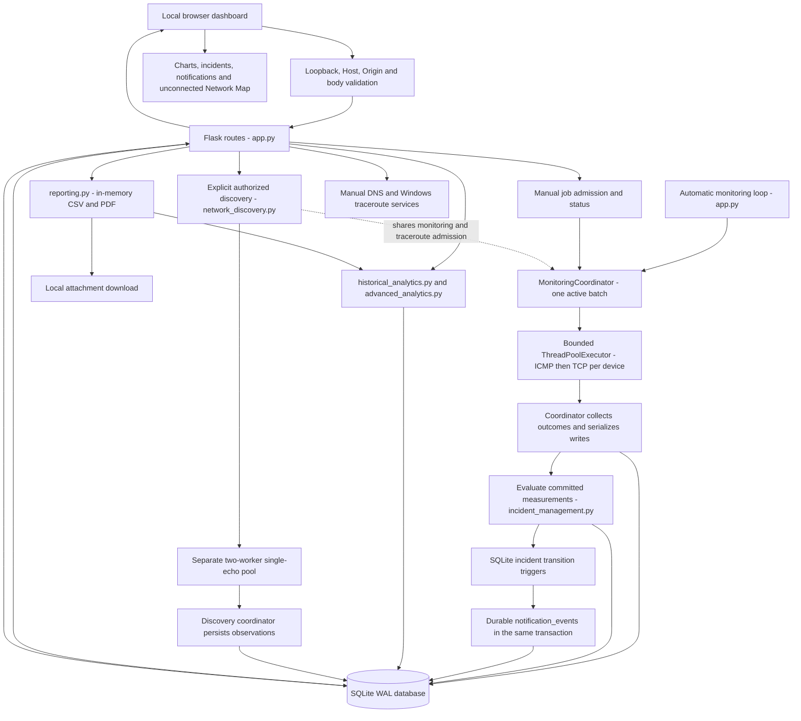

# NetScope architecture

NetScope is a local, single-user Flask application with one SQLite database and vanilla JavaScript. It is not a distributed monitoring system, authenticated team service or production remote deployment. This document describes the source at the release-preparation checkpoint; [configuration](CONFIGURATION.md) and the [feature/API reference](REFERENCE.md) give operational details.

## Data flow

Arrows describe application data/control flow, not network topology. The diagram does not imply physical links among monitored devices. Discovery's slot also excludes active traceroute; DNS retains its own independent limits.

## Modules and request boundary

| Module | Responsibility |
| --- | --- |
| `app.py` | Flask routes, configuration, destination/input validation, protocol classification, measurement adapter/persistence and launcher. |
| `monitoring_coordinator.py` | Bounded executor, shared batch admission, completion handling, process-local jobs and shutdown. |
| `schema_migrations.py` | Explicit `PRAGMA user_version` upgrades and schema/FK/index validation. |
| `incident_management.py` | Persisted condition configuration, cursors/streaks, incident evaluation and acknowledgement. |
| `incident_notifications.py` | Transition-trigger schema, stream identity, bounded event reads and idempotent read state. |
| `network_discovery.py` | Strict authorized CIDR validation, independent jobs, one-echo observations and retention. |
| `historical_analytics.py` | Existing range queries, shared RTT/loss eligibility and bounded chart points. |
| `advanced_analytics.py` | Exact bounded statistics, preceding-window trends and incident aggregation. |
| `reporting.py` | In-memory CSV/PDF export using existing analytics and measurement eligibility. |
| `application_logging.py` | Privacy-conscious structured formatter and rotating local logging. |
| `dns_diagnostics.py`, `traceroute_diagnostics.py` | Isolated manual diagnostics with quotas/deadlines; no automatic target enrollment. |
| `static/*.js`, `templates/index.html`, `static/style.css` | Dashboard state, polling, charts, feature controls and rendering. |

Every route first checks a loopback peer, localhost/127.0.0.1 Host, exact Origin when supplied, cross-site fetch metadata and the 4,096-byte body cap. Diagnostics also cap their bodies at 1,024 bytes. Monitoring/traceroute/discovery accept literal RFC1918/loopback IPv4 only, with strict port or CIDR bounds. Private addressing does not prove authorization. SQL values use parameters; subprocess commands use argument arrays with `shell=False` and deadlines. API errors are JSON, results are not cached, and framing/MIME/CSP headers restrict browser access. Local tools without a foreign Origin can still mutate state; there is no login or trustworthy operator identity.

## Monitoring lifecycle and concurrency

The `python app.py` launcher configures logs, initializes/migrates SQLite, creates the monitoring thread, then runs Flask on `127.0.0.1:5000` with debug/reloader disabled. Importing modules alone does not initialize a database or start scheduling. Using `flask run` or a multi-worker WSGI server is not the documented startup path.

An automatic loop calls `check_all()` and waits `NETSCOPE_CHECK_INTERVAL` after completion. A `MonitoringCoordinator` shares one batch lock with legacy synchronous calls, manual jobs and target mutations. Up to four device workers by default (1–16 configurable) perform five ICMP echoes then one independent TCP connection per device. Workers return `Measurement` outcomes and do not touch SQLite. The coordinating thread collects completed futures, validates results and persists one outcome at a time using short connections/transactions. Completion order can differ from target or observation order.

`POST /api/check-jobs` reserves admission before returning 202 and starts one background coordinating thread; it reuses the same pool and persistence callbacks. Competing manual requests return 409, rather than queueing another batch. The legacy `/api/check` remains synchronous. Progress counts committed task results or explicitly settled execution/cancellation failures, not submitted futures. Empty successful batches complete at 100%; partial failures retain available independent protocol measurements. Expected refusal/timeout is a measurement outcome; software failures stay unknown. No failed insert or cancelled unstarted task fabricates an offline row.

Job snapshots are thread-safe, process-local and capped at 64. Jobs are not a durable queue and vanish on restart. Graceful shutdown rejects new work, cancels queued tasks, drains started bounded probes, joins the monitoring thread and shuts down the executor. Python cannot forcibly kill running probe threads; forced termination can lose in-flight observations. Locks are process-local, so multiple NetScope processes against one database are unsupported.

## SQLite and migrations

Each `get_db()` connection enables foreign keys and a ten-second busy timeout, then commits or rolls back and closes. Initialization sets WAL before an explicit `BEGIN IMMEDIATE` migration transaction. Schema/version/configuration/seeding commit together; unsupported versions, damaged schemas/indexes and existing FK violations fail startup without resetting history. WAL configuration itself is outside that rollback. A fresh database alone receives the default loopback target; an intentionally empty inventory remains empty.

| Version | Additive change |
| --- | --- |
| 0 → 1 | Historical diagnostic/packet/RTT columns and history index, including compatible partially additive schemas. |
| 2 | Incidents, alert configuration, cursors and streaks; no historical incident backfill. |
| 3 | Acknowledgement timestamp and bounded operator note. |
| 4 | Notification events, stream metadata, unread index and transition triggers; no old-event backfill. |
| 5 | Separate discovery observations and address/history index. |

Startup also creates the guarded timestamp expression index `idx_results_observed` for range queries. Existing targets/results are preserved by migrations. Normal explicit device deletion still cascades its monitoring results, detaches incidents with retained original IDs/evidence and leaves discovery under its own retention policy. This behavior is distinct from migration preservation. Downgrade, automated repair and database backup tooling are not implemented.

## Incidents and notifications

Measurement persistence commits first. A separate incident transaction reads pending committed observations, orders them by observation time/ID, evaluates four independent conditions (ICMP/TCP unavailable, packet loss, exact high RTT), and advances durable cursors/streaks atomically. Unknown/malformed observations interrupt pending streaks and never open/resolve a network incident. Duplicate/stale timestamps cannot advance established history. Large gaps/configuration revisions reset pending streaks. Out-of-order late imports are consumed conservatively rather than reconstructing a perfect timeline.

Opening/recovery require consecutive valid qualifying observations. A partial unique index prevents duplicate active incidents per target/condition. OPEN can become ACKNOWLEDGED, and either active state resolves on verified condition-specific recovery. Acknowledgement is idempotent and never suppresses detection. Deleting a target does not invent recovery or transfer its old incidents to a reused ID.

SQLite triggers create unique opened/resolved notification events inside the incident transaction. They become visible only on commit; event failures roll back incident/cursor work while the original measurement stays saved. Later writes/startup retry pending evaluation. Structured transition logs emit after commit. Acknowledgement logs an informational event but creates no alert. Notification read state is durable, idempotent and independent of incident acknowledgement. Event APIs use bounded ID pages plus global unread counts.

In-app notifications poll stored events. Browser desktop alerts are explicit opt-in, gesture-permission-based, and best effort using Notification API, stream cursors/localStorage and stable tags. They require an open page; there is no service worker, closed-browser delivery or external provider. Multiple tabs/OS suppression can prevent exact-once display even though stored events are deduplicated.

## Discovery, diagnostics and map

Discovery starts only from an explicit authorized CIDR POST. It accepts canonical RFC1918/loopback IPv4 ranges with at most 32 usable hosts and never broadens scope. One job, two separate workers and two accepted scans/minute limit resources. It reserves monitoring admission plus traceroute's slot for the scan; busy starts return 409 and scheduled monitoring skips that attempt. No monitoring worker is consumed. Each host gets one echo, not port enumeration or fingerprinting. Started probes can finish during cancellation/shutdown; skipped work creates no observation.

Discovery persists method/time/classification independently of monitored targets, retaining at most 2,048 observations globally. Its 32 retained job statuses are process-local; observations survive restart, jobs do not resume. Explicit enrollment validates name/address/port under target admission and a SQLite transaction, rejecting an already-monitored address. Reachability is not complete enumeration: silence can reflect filtering or execution problems.

Manual DNS resolves approved public domain-name forms, filters non-public results and never connects/enrolls. Its OS resolver cannot be forcibly cancelled; a timeout retains the service slot until it finishes. Traceroute uses Windows `tracert -d -4`, explicit consent and hop/time/rate limits, and stores no diagnostic history.

The Network Map merges existing target/inventory reads into unconnected SVG nodes. /24 address buckets are display-only groupings, not measured subnet boundaries or verified physical/logical links. Pan/zoom/filtering/selection read stored data and never scan. Protocol outcomes and freshness remain independent; collection errors are unknown, stale data is labeled, and details reuse inspectors/incidents. The map caps merged addresses at 200 and cannot establish topology from IP similarity or traceroute.

## History, analytics and reports

Default inventory/history availability covers 60 stored rows per device. Range charts use the existing timestamp index, cap plotted points at 2,000/device, and retain full bounded-window summary counts. Exact cycle RTT eligibility excludes unavailable/bounded/legacy timings. Availability denominators exclude unknowns separately per protocol. Timestamp positioning and breaks over five-minute collection gaps avoid implying continuous observations.

Advanced analytics reuses that eligibility/classification path. It calculates exact cycle-mean percentiles with type-7 interpolation, minimum sample counts, packet-loss distributions, separate sampled availability, and equal preceding-window trends. Its half-open windows avoid double-counting shared boundaries; legacy chart APIs retain inclusive endpoints. Incident transition counts use confirmation/recovery observation times; recovery spans include gaps, not exact physical outages. Current unresolved age is not a reconstruction at a historical window end. Budgets are ten seconds, 100,000 measurement rows combined and 20,000 incident rows; limits return errors instead of partial statistics. No retention exists for ordinary monitoring/incident/notification history.

Reports take a consistent read snapshot using those services and release SQLite before formatting. One in-process report slot limits concurrent memory/CPU work without taking the monitoring pool/lock. CSV exports typed rows and protects spreadsheet-interpreted text; PDF uses ReportLab and embedded Vera fonts, explicit fallback escapes, wrapped tables and repeated headers. Downloads remain memory-only with private/no-store attachment headers. Raw/PDF detail, byte/page and cooperative time limits reject oversized requests. There is no durable report queue, background export archive or server-side cancellation. Read/formatting load can still affect responsiveness and WAL checkpoint reclamation.

## Frontend and failure boundaries

The dashboard fetches devices every ten seconds, then histories, comparisons, incidents, notifications, inventory and analytics. Manual/discovery job status polls every second while active and stops at terminal states. Request tokens reject stale selection/filter responses. Source-specific errors retain or clear data with visible warnings; stale map outcomes never become current simply because another endpoint succeeded. Report generation occurs only on submission and handles Blob download/revocation separately from JSON APIs.

The app uses standard logging with safe fields and rotating files. Known network outcomes are measurements; unexpected execution/database errors are logged with safe event/class metadata. Incident evaluation failure cannot retroactively turn a committed result into a failed insert. SQLite transactions, constraints, process-local admission and bounded jobs have different responsibilities; none substitute for multi-process coordination, authentication, durable measurement queues or continuous-uptime guarantees.
